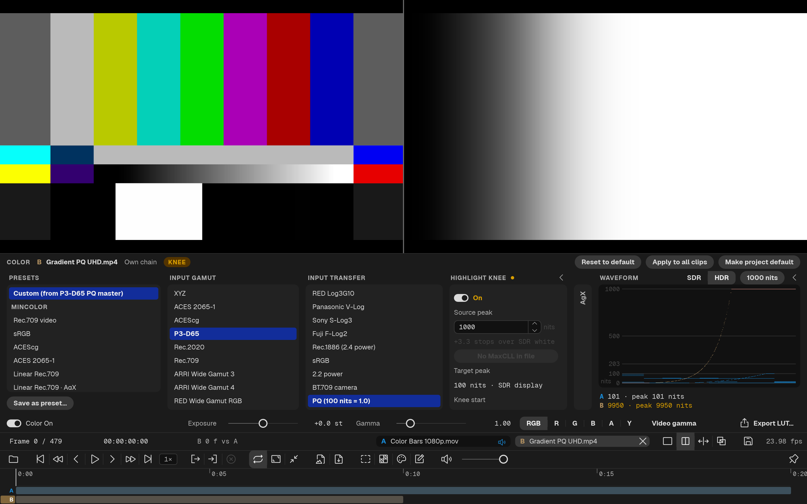

# QCView

**QCView** is a media player and reviewer for Windows and macOS, built for artists and post-production teams who need accurate, color-managed playback of video, EXR and image sequences.

Manual: **[qcview.app](https://qcview.app)**

## Download

### Windows

### macOS

A signed and notarized `.dmg` is on [GitHub Releases](https://github.com/cbkow/QCView-Player/releases/latest). It needs macOS 13.0 (Ventura) or later on Apple Silicon. QCView updates itself from there on.

## What is in this repository

This repository is QCView's home page: the manual, the releases and the update feed. The application's source code is elsewhere.

| | Where |
|---|---|
| **QCView 3 source code** | [cbkow/minplatform](https://github.com/cbkow/minplatform) (`apps/qcv`) |
| **QCView 2 source code** | the [`2.x` branch](https://github.com/cbkow/QCView-Player/tree/2.x) of this repository |
| The manual and the site (qcview.app) | [`docs/`](docs/) |
| The macOS update feed | [`docs/appcast.xml`](docs/appcast.xml), added to by [`scripts/update_appcast.sh`](scripts/update_appcast.sh) |
| Installers | [Releases](https://github.com/cbkow/QCView-Player/releases) |

QCView 3 is a rewrite of QCView 2 (Qt Quick / QML) in Rust on wgpu. It opens QCView 2's projects, notes and presets.

## Documentation

- [Manual](https://qcview.app/)
- [Privacy Policy](https://qcview.app/privacy/)
- Third-party notices: in the application, **About ▸ Licenses…**; their source is in [minplatform](https://github.com/cbkow/minplatform)

## License

QCView is free software released under the **GNU General Public License version 3**. See [LICENSE](LICENSE) for the full text. The complete corresponding source of QCView 3, including its build scripts and third-party notices, is at https://github.com/cbkow/minplatform.

Copyright © 2025–2026 cbkow.
