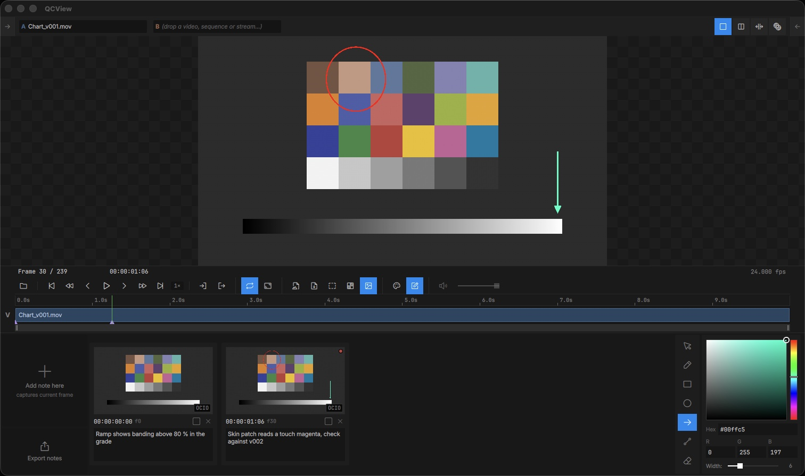

# Annotations

The Notes panel manages text notes and drawn annotations for loaded media. Annotations are saved in a `.qcview` folder alongside the media file, so they're accessible to anyone with file-system access and load automatically with the media. Notes on a live feed are kept in the project instead — see [Notes on live feeds](#notes-on-live-feeds).

Open the Notes panel with `Ctrl + 4`, the notes button on the transport bar, or the same button on the live strip when a feed is loaded.

---

## Creating Notes

Click **Add Note** to create a note at the current playhead position. A diamond marker appears on the timeline. Type in the text field.

### Drawing Tools

The annotation toolbar on the right of the Notes panel provides a pointer (select, move, scale or delete a drawn shape), freehand pen, box, circle, arrow, line and eraser, plus a color picker and a line-width slider for drawing directly on the viewport. The note's thumbnail picks up the strokes.

A stroke can start or stray off the picture: it keeps following the cursor, and only the part over the picture is drawn, saved and exported. Everything beyond the edge is kept with the note, so a shape dragged back into frame later, or moved with the pointer tool, is still whole. A gesture that never touches the picture leaves nothing behind.

| Shortcut | Action |
|---|---|
| `Ctrl + Z` | Undo stroke |
| `Ctrl + Shift + Z` | Redo stroke |
| `Esc` | Cancel the stroke in progress |

Note thumbnails are captured through the active OCIO chain and marked **OCIO**; hover the mark to see the chain.

> If the Notes panel is open, screenshots are captured with embedded annotations.

---

## Exporting Notes

Export annotations from the Notes panel's Export menu:

| Format | Details |
|---|---|
| Markdown | Creates a folder with the note text + exported images |
| HTML | Single file with embedded images |
| PDF | Single file with embedded images |
| DOCX | Single file with embedded images--combatible with Google docs |

PDFs and DOCX exports will split the content into pages. Stream notes are headed by their capture time and the host's timecode instead of a file timecode and frame.

---

## Notes on live feeds

A live source — a Premiere Pro or After Effects sequence over [QCBridgeAE](/qcbridge/adobe/), or an SRT stream — has no file to keep a sidecar beside, so its notes live in the **project**: `<project folder>/.qcview/streams/<stream name>/`, one folder per live item, with `notes.json` and the captured frames. The project has to be saved first; until it is, the Notes panel shows a **Save** tile in place of Add note. Save As to another folder carries the stream notes along.

### Live and Review

A feed has no timeline to seek, so a note pins to a **captured frame** instead of a timecode. The Notes panel shows a pill with the state:

- **LIVE** — the feed plays. Press `Space`, click the pill, or click **Add note here** to **freeze** it: the current frame is captured, and that frame is what you draw on and what the note keeps. The feed keeps arriving underneath; nothing upstream stops.
- **REVIEW · time** — a captured frame is on the viewport. Clicking a note card puts that note's frame back on screen with its strokes; `←` / `→` walk the notes in capture order. `Space`, `Esc` or the pill return to **live**, and the feed resumes from where it is now.

Switching items, changing the view mode, closing the media or opening another project returns the feed to live on its own. The captured frame is shown exactly as it was captured, so the view transform is not applied a second time; anything you send out through the [Output](/output/) section shows the same frozen frame while you review.

Each stream note records the capture time (with your time zone) and, for Premiere Pro, the sequence timecode the frame came from. The cards show both; exports use them as headings.

### Sending notes to minNotes

For a stream item, the Export panel gains **Open in minNotes**. It hands the notes folder to [minNotes](https://minnotes.app) 1.0.3 or later, which opens a document beside the notes with every captured frame as an image, QCView's strokes as ink, and the text underneath — ready to edit, reorder and export, and to pull in the notes QCView adds later with its **Insert notes** button.
