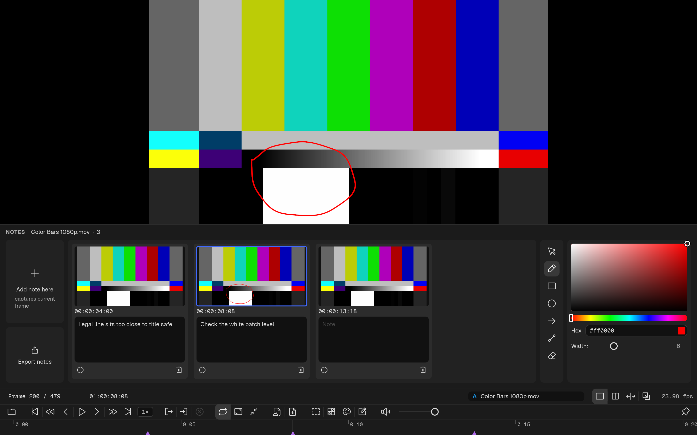
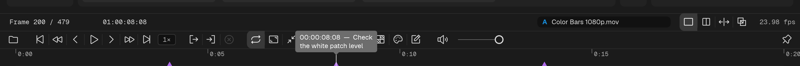
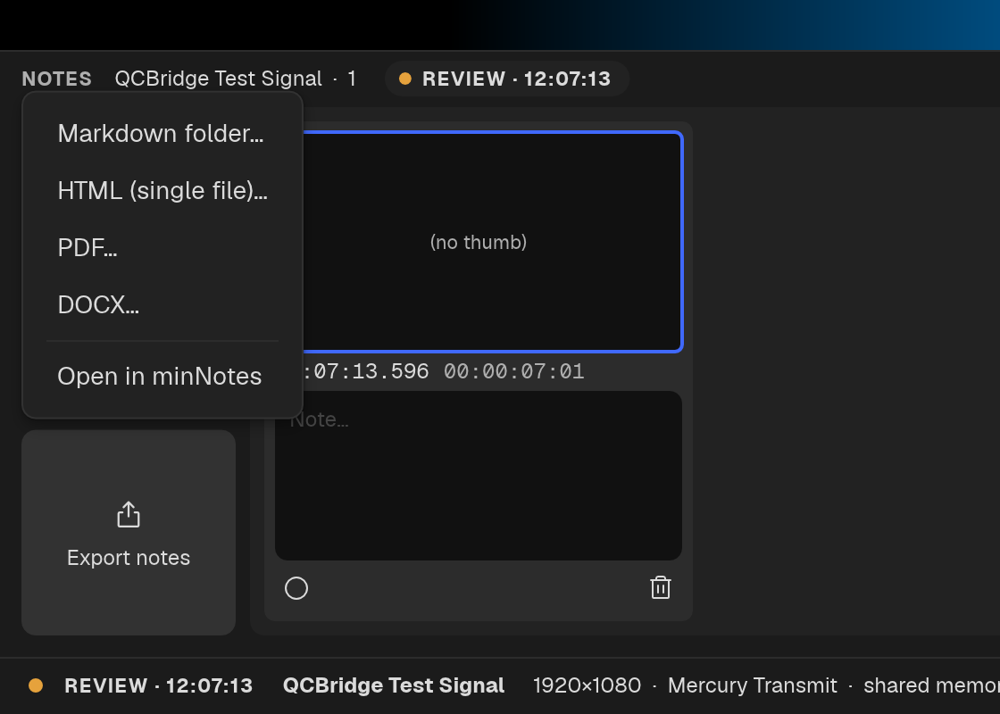

# Annotations

The Notes panel manages text notes and drawn annotations for loaded media. Annotations are saved in a `.qcview` folder alongside the media file, so they're accessible to anyone with file-system access and load automatically with the media. Notes on a live feed are kept in the project instead — see [Notes on live feeds](#notes-on-live-feeds).

Open the Notes panel with `Ctrl + 4`, the notes button on the transport bar, or the same button on the live strip when a feed is loaded. It opens as a drawer above the transport row, in the same place as the Color panel, so only one of the two is open at a time. Drag the drawer's top edge to make it taller.

Notes work in single view: a file or a live feed. The panel does not open in dual view or with a playlist loaded.

---

## Creating Notes

Click **Add note here** to create a note at the current playhead position. A card appears in the panel with a thumbnail of the frame; type in its text field. There is one note per frame. Each card has **Mark addressed** and **Delete note** buttons, and clicking a card's thumbnail jumps to its frame.

Every note also gets a pennant on the timeline: violet, filled while the note is open and hollow once it is marked addressed. Hover a pennant to read the note's timecode and text; click it to jump to the note. Pennants show whether or not the Notes panel is open. (The Compact Mode strip has none.)

If another app, such as [minNotes](https://minnotes.app), edits the same notes while the panel is open and playback is paused, QCView picks the changes up and merges them with yours.

### Drawing Tools

The annotation toolbar on the right of the Notes panel provides a pointer (select a drawn shape, drag it to move, drag a corner to scale, `Delete` to remove), freehand pen, rectangle, oval, arrow, line and eraser, plus a color picker and a line-width slider for drawing directly on the viewport. Drawing on a frame that has no note yet creates one. Strokes show on the exact frame they were drawn on, and the note's thumbnail picks them up.

A stroke can start or stray off the picture: it keeps following the cursor, and only the part over the picture is drawn, saved and exported. Everything beyond the edge is kept with the note, so a shape dragged back into frame later with the pointer tool is still whole. A gesture that never touches the picture leaves nothing behind.

| Shortcut | Action |
|---|---|
| `Ctrl + Z` | Undo stroke |
| `Ctrl + Shift + Z` | Redo stroke |
| `Esc` | Cancel the stroke in progress, or clear the selection |
| `Delete` / `Backspace` | Remove the selected stroke (pointer tool) |

Undo and redo belong to the clip that is loaded; they start over when you load another.

Note thumbnails are captured through the clip's colour chain, whichever colour engine it uses, and rendered for SDR the way [screenshots](/timeline/#screenshots) are. A card is marked **OCIO** or **VIEWER** when the note records what it was captured through.

> If the Notes panel is open, screenshots are captured with embedded annotations. With the panel closed they are not: a screenshot shows what the viewport shows.

---

## Exporting Notes

Export annotations from the **Export notes** tile in the Notes panel. Pick a format, then choose where to save:

| Format | Details |
|---|---|
| Markdown | Creates a folder with the note text + exported images, one section per note |
| HTML | Single file with embedded images. The notes are laid out as one table — thumbnail, timecode and frame, the note, addressed or not — and clicking a thumbnail opens the frame full size, where the strokes can be shown or hidden |
| PDF | Single file with embedded images, one note per page |
| DOCX | Single file with embedded images, one note per page; compatible with Google Docs |

Stream notes are headed by their capture time and the host's timecode instead of a file timecode and frame.

---

## Notes on live feeds

A live source — a Premiere Pro or After Effects sequence over [QCBridgeAE](/qcbridge/adobe/), or an SRT stream — has no file to keep a sidecar beside, so its notes live in the **project**: `<project folder>/.qcview/streams/<stream name>__<id>/`, one folder per live item, with `notes.json` and the captured frames. The project has to be saved first; until it is, the Notes panel shows a **Save…** tile in place of Add note here and the drawing tools are off. Save As to another folder carries the stream notes along.

### Live and Review

A feed has no timeline to seek, so a note pins to a **captured frame** instead of a timecode. The Notes panel shows a pill with the state:

- **LIVE** — the feed plays. Press `Space`, click the pill, click **Add note here**, or simply start drawing to **freeze** it: the current frame is captured, and that frame is what you draw on and what the note keeps. Opening the Notes panel does not freeze the feed by itself.
- **REVIEW · time** — a captured frame is on the viewport. Clicking a note card puts that note's frame back on screen with its strokes; `←` / `→` walk the notes in capture order. `Space`, `Esc` or the pill return to **live**, and the feed picks up from where it is now.

A frame you have just frozen is shown through the clip's colour chain, like the live picture. A saved note's frame is shown exactly as it was captured, so the chain is not applied a second time.

Each stream note records the capture time (with your time zone) and the host's timecode when the host sends one. The cards show both; exports use them as headings.

### Sending notes to minNotes

For a stream item, the Export notes menu has a last row, **Open in minNotes**. It hands the notes folder to [minNotes](https://minnotes.app) 1.0.3 or later, which opens a document beside the notes with every captured frame as an image, QCView's strokes as ink, and the text underneath — ready to edit, reorder and export, and to pull in the notes QCView adds later with its **Insert notes** button. When minNotes is not installed the row is greyed and says so.
