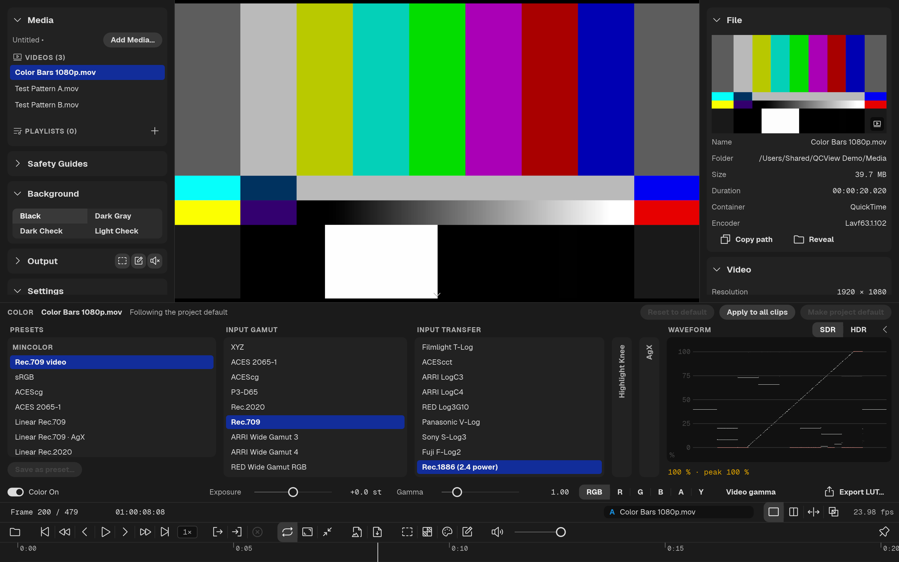
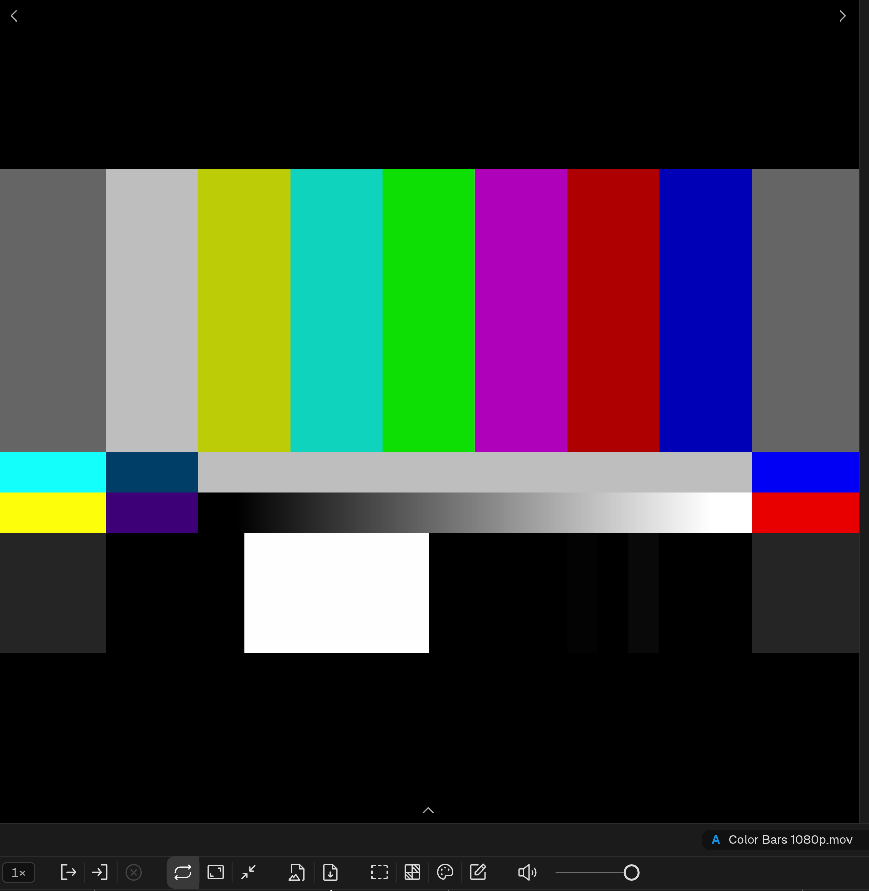
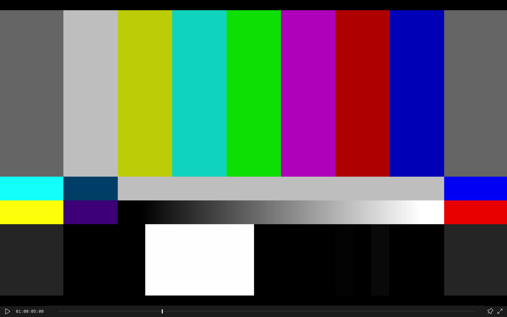
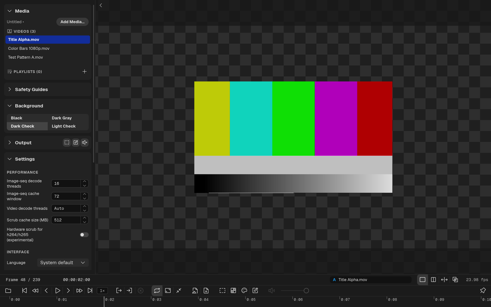
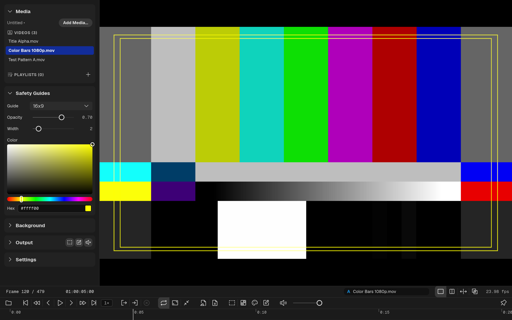
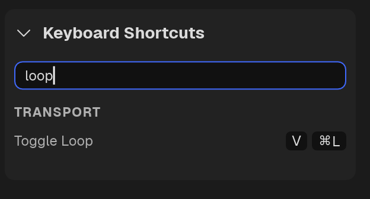
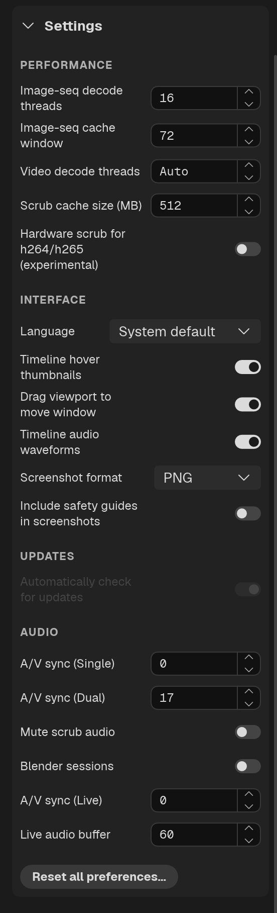

# App Basics

Shortcuts on this page are written the Windows way. On macOS, `Ctrl` is `⌘` and `Alt` is `⌥`.

## Opening Files

### File Menu

Use the **File** menu to load media into QCView:

<!-- SHOT qcv3_002: The File menu open: Open Media…, Open Stream…, Connect to After Effects, Connect to Premiere Pro, Connect to Blender, Open Recent Media, New Project, Open Project…, Open Recent Project, Save Project, Save Project As…, Copy Project Link -->

| Action | Shortcut |
|---|---|
| Open Media… | `Ctrl + O` |
| Open Stream… | Opens a live stream by URL (e.g. `srt://…`), with an optional name and passphrase |
| Connect to After Effects | Receive a live source from the [QCBridgeAE](/qcbridge/adobe/) add-on |
| Connect to Premiere Pro | Receive a live source from the [QCBridgeAE](/qcbridge/adobe/) add-on |
| Connect to Blender | A checkable item: listen for a [QCBridge for Blender](/qcbridge/blender/) session. The same switch as **Blender sessions** in [Settings](/settings/) |
| New Project | `Ctrl + N` |
| Open Project… | `Ctrl + Shift + O` |
| Save Project | `Ctrl + S` |
| Save Project As… | `Ctrl + Shift + S` |
| Copy Project Link | Copies a `qcview://` link to the saved project (see [Project Links](/project-manager/#project-links)) |
| Exit (Windows) | `Ctrl + Q`. On macOS, Quit is in the app menu (`⌘ + Q`) |

Recent media and recent projects are also reachable from the **Open Recent** submenus. The **Open media…** button at the left end of the transport row opens the same dialog as `Ctrl + O`.

The passphrase you type in **Open Stream…** is hidden as you type, and it is left out wherever the stream's URL is shown afterwards (the recent list, the Inspector, Copy URL). Paste works in every text field.

### Drag and Drop

You can drag files directly into the app:

- Drop one or more files on the **viewport** to add them to the project and load the first one.
- Drop them on the **Left Rail** to add them to the project.
- Drop a `.qcvproj` file to open that project.
- With a playlist loaded, drop on the timeline to insert into the playlist (see [Playlists](/playlists/)).
- In dual view, drop on the **A** or **B** chip, or on that side of the picture, to load that side (see [Dual Video Review](/dual-view/)).

<!-- SHOT qcv3_003: A file being dragged from the desktop over the Left Rail's Media section -->

To load files already in your project, double-click them in the Media section or drag them into the viewport.

A file type QCView does not open is refused with a short message. A folder is refused too: drop a file, or any frame of an image sequence.

On Windows, a shortcut (`.lnk`) to a clip works wherever the clip itself would: dropping it, opening it from a dialog or the command line all load the file it points to, and the project lists that file.

---

## Layout

The picture sits above three bands: the **status strip** (frame, timecode and frame rate, plus the dual-view controls), the **transport row** and the **timeline**. A rail on each side holds the panels, and the Color and Notes panels open as drawers between the picture and the bands.

### Panels

Toggle panels from the **View** menu or with keyboard shortcuts:

| Panel | Shortcut |
|---|---|
| Left Rail (Media, Safety Guides, Background, Output, Settings) | `Ctrl + 1` |
| Right Rail (Inspector, Keyboard Shortcuts) | `Ctrl + 2` |
| Color Panel | `Ctrl + 3` |
| Notes | `Ctrl + 4` |

You can also use the mouse:

- **Rails.** Each rail has a small caret tab floating beside it, over the picture. Click it to collapse the rail and again to bring it back. Drag a rail's inner edge to change its width. On a fresh install the Right Rail starts collapsed.
- **Color and Notes.** These are drawers above the transport row, and only one is open at a time: opening one closes the other. Each has a button on the transport row. The caret under the picture closes whichever drawer is open; with neither open it opens the Color panel. The Notes panel is available in single view only (a file or a live feed), not in dual view or with a playlist loaded.

The rails' widths, which rails are open, and the window's size and position are remembered between launches.

### Layout Presets

| Preset | Shortcut | Description |
|---|---|---|
| Compact Mode | `Ctrl + Shift + C` | Viewport plus one slim strip: play / pause, timecode, a scrub line, the pin and exit. Press `Ctrl + Shift + C` again, `Esc`, or the strip's exit button to leave; your panels come back as they were |
| Always on Top | `Ctrl + Alt + T` | The window stays above every other app's — handy for a reference beside an editor or a browser. The pin button at the right end of the transport row and on the Compact strip is the same toggle; the choice is remembered |
| Fullscreen | `F` | The picture alone. Rest the pointer at the bottom edge of the screen and the status strip, transport row and timeline appear; they go away shortly after the pointer leaves. Press `F` or `Esc` to exit |
| Default Size & Position | View menu | Puts the window back to its first-run size, centred on the screen it is on |

Compact Mode is for a window that is nothing but the picture: every panel, rail and band goes away, the window loses its title bar, and one strip under the viewport keeps a play / pause button, the timecode, a scrub line with the playhead and in / out marks, a pin (Always on Top) and an exit button; `F` still toggles fullscreen. The transport row has a Compact Mode button next to fullscreen. Drag the timecode, or the picture itself, to move the window. Scrubbing on the strip works the way the timeline does. On a live source the timecode reads **LIVE** and a red dot sits at the start of the line. On macOS the menu bar stays at the top of the screen; on Windows the menu is hidden with the rest of the chrome, so use the shortcuts.

QCView 3.0 has no Minimal Mode, Show All Panels or Status Bar toggle. The status strip is always shown, and Compact Mode and fullscreen cover the picture-only cases.

---

## Backgrounds and Overlays

### Backgrounds

QCView provides background options for reviewing alpha-channel media: **Black**, **Dark Gray**, **Dark Check** and **Light Check**. Open the **Background** section in the Left Rail (Tools menu → Background, or the Background button on the transport row), or press `B` to step through the four.

### Title Safety Guides

Open the **Safety Guides** section in the Left Rail (Tools menu → Safety Guides, or the Safety guides button on the transport row) to overlay a broadcast or social-media safety guide on the picture. Pick one from the **Guide** list (or **(none)**), and set its **Opacity**, **Width** and **Color**. All four choices are remembered.

Guides are left out of screenshots unless you turn on **Include safety guides in screenshots** in [Settings](/settings/).

---

## Keyboard Shortcuts

The full keyboard shortcut reference lives at the bottom of the Right Rail under **Keyboard Shortcuts** (`Ctrl + /`, or Tools menu → Keyboard Shortcuts). The shortcut opens the rail and scrolls the card into view. Type in the **Filter shortcuts** field to narrow the list by action, by group heading or by key: `loop` leaves Toggle Loop, and `ctrl+k` leaves the two cut commands.

## Settings

The Settings panel opens in the Left Rail (`Ctrl + ,` or Tools menu → Settings…). See [Settings](/settings/).

## About and Licenses

The **About** menu holds **Docs**, which opens this site, and **Licenses…**, which opens the full third-party notices that ship with the app. On macOS it also has **Check for Updates…**.
