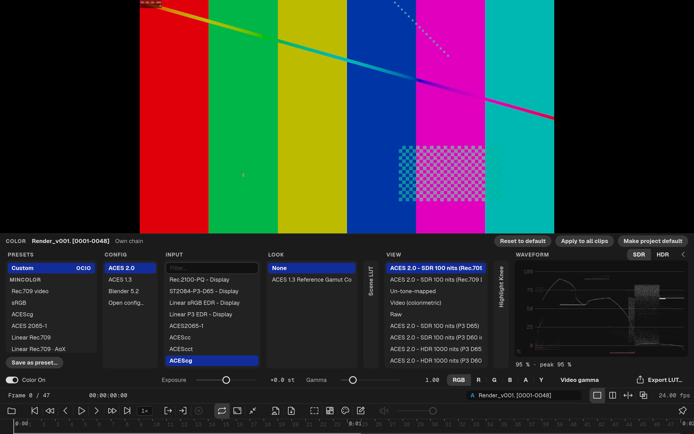
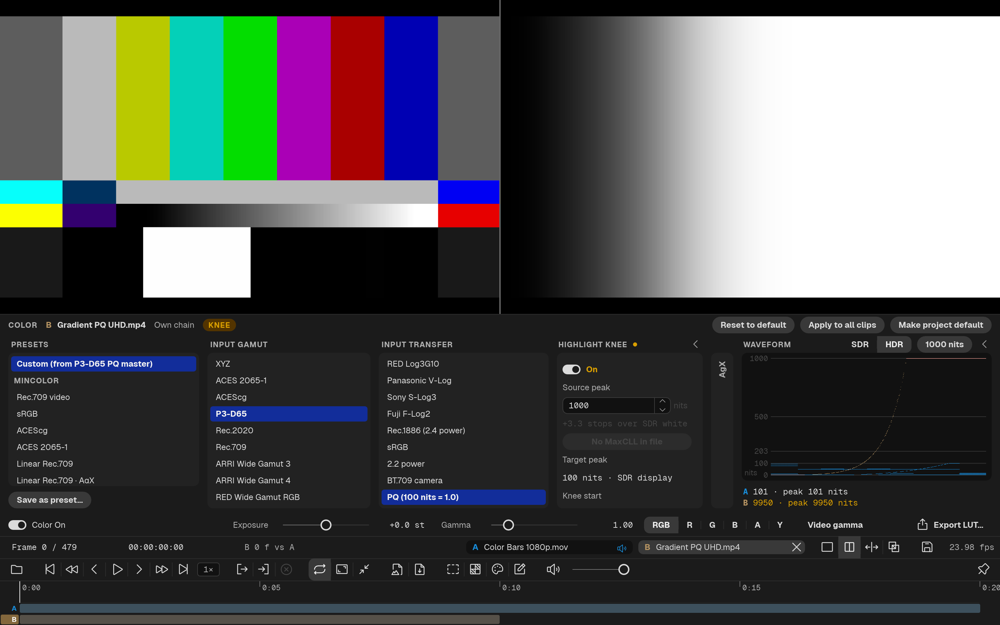
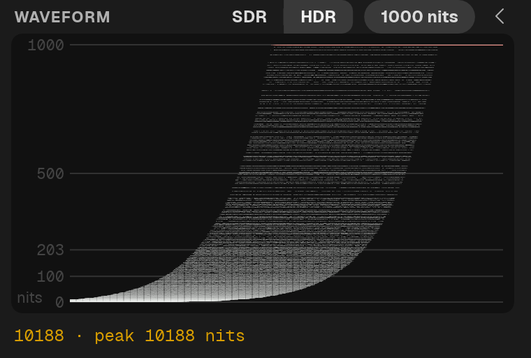

# Color

Color management lives in the **Color** drawer, a panel that opens above the transport and pushes the picture up. Open it with `Ctrl + 3`, **View > Color Panel**, the palette button on the transport, or the caret under the picture. Color and Notes share that space, so opening one closes the other. Drag the drawer's top edge to resize it. The drawer is not available in fullscreen or Compact Mode.

QCView has two color engines:

- **[minColor](/mincolor/)** — the default. A fixed chain with no config file; every built-in preset uses it.
- **OCIO** — a live [OpenColorIO](https://opencolorio.org/) pipeline, for when you need a config's own colorspaces, looks, and views. Start one with **New OCIO chain…** in the preset list.

**Bundled OCIO configs:** ACES 2.0, ACES 1.3, Blender 5.2. You can also load a config file of your own.

The **Color On / Off** switch at the bottom left covers whichever engine a clip uses. Color is off when QCView starts and when you start a new project. Opening a project in which a clip has its own chain turns it on, and so does picking a preset or changing any column.

With Color off, no chain is applied: the picture is decoded from the file's own tags.

---

## One chain per clip

Each clip has one whole chain: its Input, everything in between, and how it is rendered for the screen. There is no shared "view" half; two clips can be read and shown in completely different ways.

The drawer's header names the clip you are editing and says where its chain comes from:

- **Following the project default** — the clip has no chain of its own and uses the project's default chain.
- **Own chain** — the clip has been given its own chain. Picking a preset or changing any column does this.

Three buttons sit at the right of the header:

| Button | What it does |
|---|---|
| **Reset to default** | Removes the clip's own chain, so it follows the project default again |
| **Apply to all clips** | Gives this chain to every video, still and sequence in the project (audio items and live sources are skipped) |
| **Make project default** | Makes this clip's chain the project default |

With nothing loaded, the header reads **Project default** and the drawer edits the default chain directly. A project that has never set one uses the **Rec.709 video** preset.

Clip chains and the project default are saved with the project.

---

## Presets

The **Presets** list is the first column, and it is one list for both engines:

- **minColor** — the built-in presets. See [minColor](/mincolor/#presets).
- **Yours** — presets you have saved, each tagged with its engine. The heading appears once you have saved one.
- **OCIO** — **New OCIO chain…**, which puts the clip on OCIO starting from the ACES 2.0 config. Pick another config in the Config column.

A preset is a starting point, not a live link: picking one copies its chain onto the clip. As soon as you change a column, the list shows a **Custom (from …)** row at the top, and **Save as preset…** under the list becomes available. Give the preset a name and it joins **Yours**.

Right-click one of your presets for **Rename…**, **Update to this chain** (overwrite the preset with the chain you are looking at) and **Delete**. The built-in presets cannot be changed.

Your presets are kept with the app's settings, not in the project, so they are there for every project. Picking an OCIO preset puts the clip on OCIO; picking a minColor preset puts it back on minColor. Presets saved in QCView 2 are not carried over.

---

## The OCIO columns

On an OCIO chain the drawer reads left to right: Presets, **Config**, **Input**, **Look**, **Scene LUT**, **View**, **Highlight Knee**, then the waveform. If the window is too narrow for all of them, the columns scroll sideways; the waveform stays put.

- **Config** — ACES 2.0, ACES 1.3, Blender 5.2, or **Open config…** to load a `.ocio` file of your own. When you change config, the Input, Look and View keep their names where the new config has them; a missing Input falls back to the config's scene-linear space, a missing View to an SDR view where the config has one, and a missing Look to None.
- **Input** — the clip's source colorspace. Type in the filter field to narrow the list.
- **Look** — an optional creative look from the config, or **None**.
- **Scene LUT** — see [below](#scene-lut).
- **View** — the config's view. There is no display or output to choose: QCView picks the surface for your monitor by itself (see [HDR](/hdr/)).
- **Highlight Knee** — see [below](#highlight-knee).

Scene LUT and Highlight Knee collapse to a narrow strip when they are not in use; click the strip to open it. A dot on the strip shows that it is active.

### Scene LUT

An optional LUT or CDL file applied to the Input's own values, after the Look. Click **+ Add LUT** and choose a file; the card then shows the file's name and **Replace LUT**, and the **✕** clears it.

- **Formats:** `.cube`, `.3dl`, `.csp`, and the ASC CDL formats `.cc`, `.ccc`, `.cdl`.
- **Correction ID** — for a `.ccc` or `.cdl` file, a field under the file picks the correction, by id or by index. Leave it empty to use the first one. Press Enter or click elsewhere to apply it.

The Scene LUT is part of the clip's chain, so Reset to default, Apply to all clips and presets all carry it. It is available on OCIO chains only.

If the file cannot be loaded (it is missing, malformed, or the Correction ID is not in it), a red message names the file, the card shows the reason, and that clip is shown with Color bypassed until you fix or clear the LUT.

Two limits to know about:

- A LUT file that is edited on disk under the same name is re-read only after QCView restarts.
- The LUT's path is stored as you chose it. A project opened on another machine or OS finds the file only if the same path exists there.

**QCView 2 projects.** A clip that had a Scene LUT in QCView 2 keeps it in the project, but the LUT is not applied on open; a notice says so. Give that clip an OCIO chain and its QCView 2 Input, Look, Scene LUT and Highlight Knee are taken over into the new chain.

---

## Dual view

In [dual view](/dual-view/) each side is a clip, so each side has its own chain. The drawer edits the selected side, the one whose A / B chip or timeline lane you clicked last. The header leads with that side's letter in its color, then the clip's name.

An SDR render can sit beside a PQ master this way, each read through its own Input, with the Highlight Knee on for the HDR side only.

---

## Highlight Knee

An optional step that compresses highlights above a chosen level into the display's range, for checking HDR material on a display that can't show it all. Both engines have it, and it is the only tone mapping QCView applies to the screen: nothing is compressed unless you turn this on.

- **Source peak** — the brightest level in the source (nits). The button under it takes the value from the file's HDR metadata: **Use file MaxCLL**, or **Use mastering peak** when the file carries no MaxCLL.
- **Target peak** — the level the highlights are brought down to. On an OCIO chain with an SDR view it is fixed at 100 nits.
- **Knee start** — where the compression begins; defaults to the BT.2390 knee. Drag the slider to set it by hand; double-click the slider, or use the reset button, to go back to BT.2390.

While the knee is compressing, a yellow **KNEE** pill sits in the drawer's header as a reminder that the picture is not 1:1. The knee is part of the clip's chain and is saved in presets.

---

## Viewer aids

The bottom row holds inspection aids for looking into the picture. They are captured in screenshots, and are never saved in presets, shown in thumbnails or baked into an exported LUT. They do not move the waveform.

| Control | What it does |
|---|---|
| **Exposure** | Linear gain, in stops (±4) |
| **Gamma** | Lifts (> 1) or lowers (< 1) the result, 0.25–4 |
| **RGB / R / G / B / A / Y** | Show all channels, one channel, alpha, or luma |

Double-click a slider to reset it. The reset arrow at the end of the row, shown while any aid is active, clears all three.

### Video gamma

**Video gamma** shows the picture the way an unmanaged Rec.709 desktop does: black and white stay where they are, and shadows and midtones come out lighter than in the accurate view. It is an emulation for people who work that way, not a reference.

- It acts only with Color on and only on an SDR picture. With Color off, or while the picture is shown in HDR, the button is greyed and its tooltip says why. It does not act in dual view's difference mode.
- While it acts, a yellow **VIDEO GAMMA** pill sits in the drawer's header.
- It is one setting for the whole app, remembered between launches. It is not part of a clip's chain or a preset.
- Screenshots, note images, thumbnails, the [outputs](/output/) and Export LUT carry it. The waveform does not: it keeps reading the source.

---

## Waveform

The waveform is the card at the right end of the drawer. Click its caret to collapse it to a strip, and the strip to open it again. It shows the signal's level by image column.

The waveform reads the source, not the finished picture:

- **Color on** — through the clip's Input (minColor's Input gamut and transfer, or the OCIO Input). The Look, Scene LUT, Knee, View and viewer aids never move it.
- **Color off** — from the file's tags, or from the **Transfer** choice in the [Inspector](/inspector/) when you have set one.

It has two scales, picked with the **SDR** / **HDR** chips:

- **SDR** — percent, 0–100 %, with room above and below so super-whites and sub-blacks show.
- **HDR** — luminance in nits, with lines at 100 and at **203**, HDR graphics white (BT.2408). The button beside the chips sets the top of the scale; click it to step through 300, 600, 1000, 2000 and 4000 nits. PQ and HLG sources plot their absolute luminance; an SDR or scene-linear source puts its white at 100 nits.

Until you pick a chip, the scale follows the source: HDR for PQ and HLG sources, SDR for everything else. Your pick, the top of the HDR scale and whether the card is open are remembered between launches.

Under the trace, the readout gives the brightest level in the current frame and the clip's **peak** since it was loaded. It turns yellow when the peak is over the top of the scale. Hover it for the brightest channel.

In dual view, both sides are drawn on the one waveform, A in cyan and B in tan, each read through its own clip's Input, with a readout line per side.

**Sources without usable tags** — an HDR export whose file carries no transfer tag reads as SDR. With Color on, give the clip the right Input. With Color off, tell QCView what it is with the Inspector's **Transfer** choice; live sources have the same choice on the live row. See [HDR](/hdr/#hdr-sources-without-tags).

---

## Export LUT

**Export LUT…** at the right end of the bottom row bakes the chain you are editing to a 65³ `.cube` file for use in other software. It works for either engine, with Color on or off. On an OCIO chain it needs an Input and a View.

- The LUT takes the Input's code values in and gives the chain's SDR picture out, sRGB-encoded. A chain that renders for HDR is exported through its SDR equivalent, the same way a screenshot is taken.
- It includes the Look, the Scene LUT and the Highlight Knee. If the knee had to be left out, the message after the export says so.
- It includes **Video gamma** when that is lit and acting; the message then reads "LUT exported with Video gamma".
- It never includes Exposure, Gamma or the channel view.
- QCView does not suggest a file name; you choose one.

One limit: the LUT has no shaper, so it covers input values from 0 to 1 only. For a scene-linear Input that means nothing brighter than 1.0 is represented.
