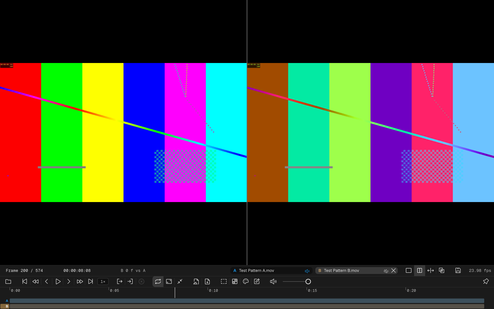
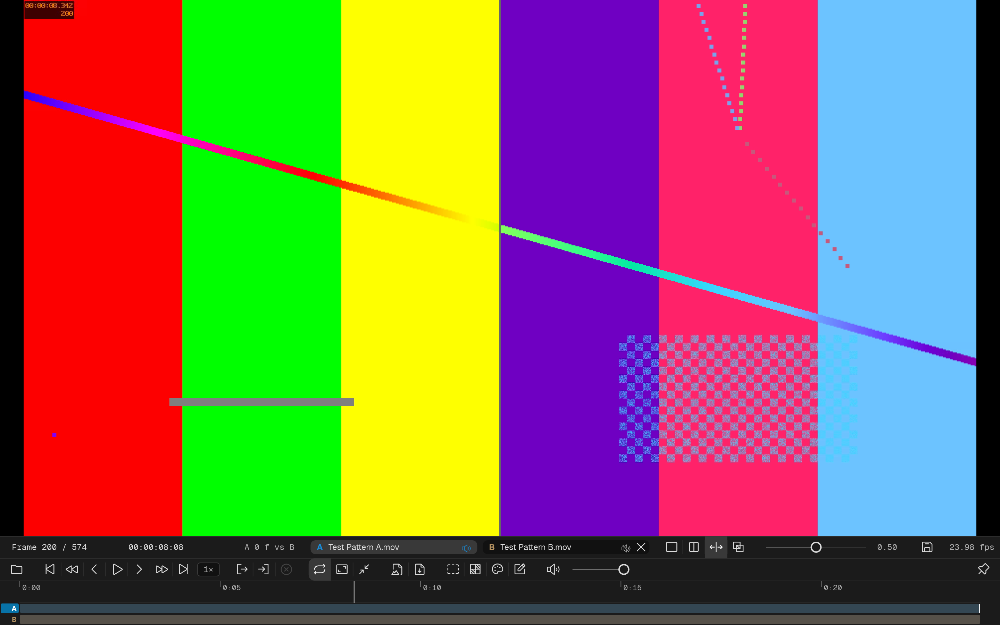
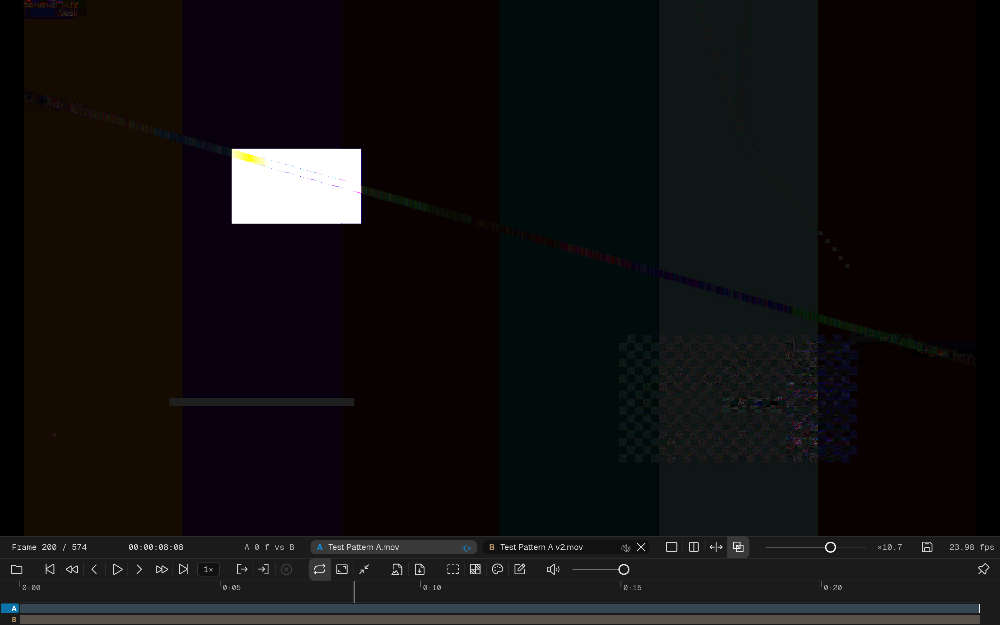
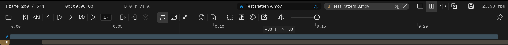
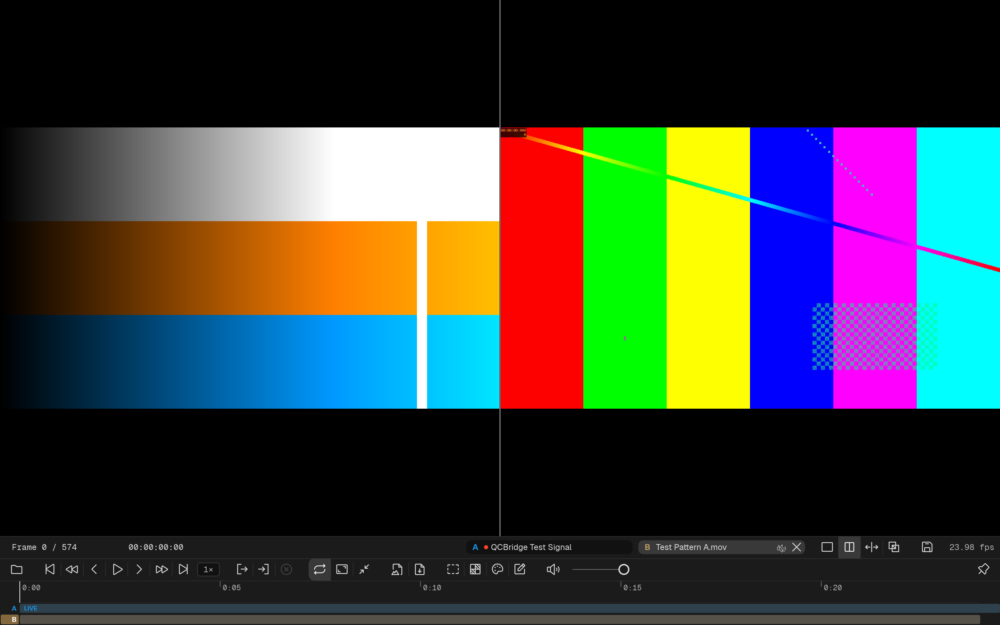

# Dual View

Dual View compares two sources, **A** and **B**, in one viewport. Its controls sit on the right of the status strip, beside the frame and timecode wells: an **A** chip and a **B** chip that name each side's source, four mode buttons, a slider for the wipe's seam or the difference gain, and Save.

## Loading the two sides

- **A** is whatever you load the usual way: a double-click in the Media section, the Open button, the File menu, or a drop.
- **B** is loaded by dragging an item from the Media section, or a file from the desktop, onto the **B** chip. A video, an image sequence or a live source can be a side; an audio-only file cannot.
- Press **Side-by-side**, **Split wipe** or **Difference** to enter dual view. The project remembers its B source, so the mode buttons bring it back.

Both chips are drop targets and show an outline while something hovers over them. In dual view the picture is a drop target too: in Side-by-side the left half replaces A and the right half replaces B; in Split wipe the seam decides; in Difference a drop on the picture replaces A.

A dual mode can be switched on before anything is loaded, and either side can be empty: the empty chip reads "(drop a file…)" or "(drop a video, sequence or stream…)", and clearing B with the chip's **×** empties that side without leaving the mode. Dual view is a state that sticks: loading a new A source **swaps the A side in place and keeps B**, along with the playhead, the in and out points and B's edits. Replacing B does the same for A.

Dual view ends when you press **Single view**, or when you load a playlist or an audio file. The mode buttons are hidden while a playlist is loaded. Going back to Single view keeps A at the same time; B stays remembered, but clip edits on the lanes are kept only if you save them as a Dual View (below). The mode, the seam position and the gain start from their defaults at each launch.

## View modes

| Mode | What you see |
|---|---|
| **Single view** | Only the A source. Choosing it leaves dual view |
| **Side-by-side** | A on the left, B on the right |
| **Split wipe** | One image with a vertical seam between A (left of the seam) and B (right of the seam) |
| **Difference** | Per-pixel `abs(A − B)`: areas that match are pure black, and any difference lights up — the classic "blink test" for spotting changes between two versions |

In **Split wipe**, the seam can be dragged directly on the viewport — hover the seam line until the resize cursor appears, then click and drag. The slider on the status strip stays in sync with the seam position.

In **Difference**, the same slider becomes a **gain** control, from ×1 to ×16. Subtle differences (a light recompression, a small grade shift) are near-black at the default gain of ×1; raise the gain to amplify them into visibility. Aligned regions stay black at every gain level. The diff is cleanest when A and B share the same resolution and framing.

## Playback

One clock drives both sides. It runs at the rate of the faster side and for the length of the longer one, and each side shows the frame that belongs to that moment (the slower side repeats frames). An image sequence keeps its own frame rate. Where a side has nothing to show — a gap between its clips, or past its end — the background shows. With looping off, playback stops at the end.

Hovering the scrubber shows the hover thumbnails as a pair, A above B.

## The selected side

One side is always the **target**: the side whose chip or lane you clicked last (B, to begin with). On the two lanes under the scrubber, each lane has a label cell at its left end, and the target's cell is filled with its side's colour — cyan for A, tan for B.

The target side is the one that:

- takes `Ctrl + K` / `CMD + K` and the other edit keys below;
- the **Color** drawer edits — its label leads with the side letter;
- the **Inspector** shows — its Range, Mix, Aspect, Rotation and Transfer choices act on that side's clip.

## Color per side

Each side renders through its own clip's colour chain, so an SDR render and an HDR master can be compared with each read correctly. There are no A / B tabs and nothing is shared between the sides: click a chip or a lane, and the Color drawer edits that side's clip. The waveform overlays both sides, A in cyan and B in tan, with a readout line per side. See [Color](/color/).

## Audio

The chip of a side that has audio carries a small speaker pill; click it to mute or unmute that side. **A is heard and B is muted by default.** The master volume and mute (`M`) act on both. The Inspector's **Mix** choice routes the selected side's channels as it does in single view.

A separate **A/V sync (Dual)** value in Settings is stored for dual view (different from the single-view value) — your offset for compositing two sources doesn't get applied to single-source playback and vice versa.

## Aligning clips

Each side has a lane under the scrubber, A above B, and the clips on them are edited directly — there is no edit mode to switch on.

| Gesture | What it does |
|---|---|
| Click a clip | Seeks there, selects the clip and makes its side the target |
| Drag a clip's body | Slides it in time. The later clips on its side move with it; hold `Shift` to move it alone |
| Drag a clip's end | Trims its head or tail |
| `Ctrl` / `CMD` + drag | Slips the source inside the clip |
| Double-click a clip | Opens a small popover with Source in, Source out and Duration as timecode, for frame-exact values |

Trims and slides snap to the playhead, the other side's cuts, the in and out points and the side's own clip edges; a line marks the snap, and a badge shows the change and the resulting frame. While you trim or slip, that side of the viewport shows the frame you are setting.

Keys act on the selected clip, or else on the target side's clip under the playhead:

| Key | What it does |
|---|---|
| `[` | Trim the clip's head to the playhead |
| `]` | Trim the clip's tail to the playhead |
| `Ctrl + K` (Windows) / `CMD + K` (macOS) | Cut the target side at the playhead (for example to clip off slates or unwanted heads) |
| `Alt + ←` / `Alt + →` | Slide the clip one frame; with `Shift`, ten frames |
| `Delete` | Remove the selected clip and leave a gap |
| `Shift + Delete` | Remove the selected clip and close the gap |
| `Ctrl + Z` / `Ctrl + Shift + Z` (`CMD` on macOS) | Undo / redo an edit |

The status strip shows a clip's offset against the other side to the right of the timecode, for example "B −14 f vs A": for the clip under the pointer, else the selected clip, else the target side's clip under the playhead.

A slide or a head trim that would pass the start of the timeline moves every other clip, on both sides, later by the overshoot instead of stopping at frame 0.

## Live sides

A live source — a QCBridge feed from After Effects or Premiere Pro, a Blender session, or a network stream — can take either side, against a file, an image sequence, another live source, or nothing.

- **Getting in.** Drag the live item onto a chip, or drop a stream link (for example an `srt://` address) on a chip or on a side of the picture. While a live item is loaded in single view, the A / B chips and the mode buttons sit on the live row, so a mode button enters dual view with the running feed as A. A running feed moves in and out of dual view without reconnecting.
- **The chip** of a live side shows a dot: red while frames arrive, yellow otherwise. Its tooltip gives the feed's status.
- **The lane** of a live side holds one bar labelled **LIVE**. It has no clip: there is nothing to trim, slide or cut, and it plays whenever the source sends.
- **No sync between the sides.** The transport drives the file side only; the live side keeps showing its newest frame while the file side is paused, stepped, shuttled or scrubbed.
- **Audio.** A live side starts **muted**, on either side — the host application is usually playing the same sound in the room. Unmute it with its chip's speaker pill. The live row's Listen button belongs to single view and has no say here. A network stream has no audio in QCView.
- **Color.** A live side has its own colour chain and its own **Transfer** choice, like any clip. Select the side to see the live cards in the Inspector.
- **Two live sides, or a live side with the other side empty.** There is no clock to drive, so the transport, the scrubber and the lanes hide, and the live row stands in with the dual controls on it. It shows the selected side's feed, and its Transfer chip acts on that side.
- The same live item cannot be on both sides; QCView says so and leaves the sides as they were.

When two host feeds are the two sides, they share one A/V sync offset.

Notes are not available in dual view; freeze and annotate a feed in single view.

## Screenshots and outputs

Screenshots (`T` to the Desktop, `Ctrl + T` / `CMD + T` to the clipboard) are taken at source resolution: Side-by-side gives both pictures at their own size next to each other, Split wipe and Difference give one picture. The file is named after the saved Dual View, or `<A>_vs_<B>`.

The [Output](/output/) section sends the dual layout as the viewport shows it. The audio that goes out is the first side that is heard: A when both are unmuted.

## Save / Recall

**Save dual view** (the floppy-disk button at the right end of the dual controls) opens a small dialog with a name field, prefilled with "A's name vs B's name". **Save** stores the current A + B, the clip edits on both lanes and the in and out points as an item under **Dual Views** in the Media section. Rename it there like any other item.

Double-click a saved Dual View to load it: both sides, side by side, with their edits. While the session comes from a saved Dual View, an **Update** button appears beside Save and overwrites that item with the current state; Save then makes a new one.

A Dual View with a live side can be saved too. The live side has no clips to store; loading the Dual View puts the live item back on its side.
