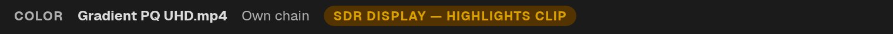

# SDR vs HDR

QCView has no display mode to choose. It picks the drawing surface for the monitor the window is on, by itself:

- **macOS** — one extended-range (EDR) surface on every display. The system gives it whatever headroom the display has.
- **Windows** — a 10-bit sRGB surface on an SDR monitor, and a floating-point scRGB surface on a monitor with HDR turned on. QCView follows the monitor that holds most of the window, so dragging the window from one monitor to the other switches the surface.

On both systems HDR brightness is relative, not absolute: 100 nits in a PQ picture is shown at your display's SDR white, and a 1000-nit highlight at about ten times that, inside the display's headroom. The picture moves with the system's brightness setting like everything else on screen.

Presets are not tagged SDR or HDR and none are dimmed: a clip's chain is the same on any display.

---

## HDR on an SDR display

QCView does not tone map by itself. On a display with no HDR headroom, a picture that goes above SDR white is shown as its chain renders it, and everything above SDR white clips.

When that is happening, the [Color](/color/) drawer's header shows a yellow **SDR display — highlights clip** pill. It appears only when both are true: the window's screen has no HDR headroom, and the picture can exceed SDR white (an HDR file with Color off, a minColor chain that ends in HDR, or an OCIO chain with an HDR view).

To see into those highlights, turn on the clip's [Highlight Knee](/color/#highlight-knee): it compresses everything above your chosen source peak into the display's range instead of clipping it, and shows a yellow **KNEE** pill while it does. Once the knee brings the picture down to 100 nits, or the window moves to an HDR screen, the clipping pill goes away.

---

## HDR sources

Tell QCView what the source is with the clip's Input. The Input stays with that clip, so SDR and HDR clips can sit side by side in the same project or dual view.

- **[minColor](/mincolor/)** — set **Input gamut** and **Input transfer**: Rec.2020 with PQ for a BT.2020 PQ master, P3-D65 with PQ for a PQ master graded in P3-D65 (the **P3-D65 PQ master** preset), Rec.2020 with HLG for HLG.
- **OCIO** — pick the source's colorspace as the **Input**, and an HDR view. In the Blender 5.2 config the inputs are named `Rec.2100-PQ`, `ST2084-P3-D65` and `Rec.2100-HLG`; the ACES configs carry the same names with a ` - Display` suffix.

With Color off, an HDR file is decoded from its own tags and shown in HDR where the display allows.

The Inspector's **HDR metadata** row shows the file's MaxCLL, MaxFALL and mastering peak when the container carries them.

---

## HDR sources without tags

Some HDR exports carry no transfer tag, and a live source never carries a file's tags: a network stream brings what its encoder put in the bitstream, and a QCBridge host feed is the host's working space, untagged by nature. QCView treats an untagged source as SDR.

- **Files, stills and sequences** — set the **Transfer** choice in the [Inspector](/inspector/) (the Color group for video, the Image Sequence group for sequences and stills): `SDR 709`, `PQ 2020`, `PQ P3`, `HLG`, or `Linear` for a scene-linear source. **Auto** tells you what the tags resolve to before you override them, for example "Auto (SDR, untagged)".
- **Live sources** — the same choice is a chip on the live row. A stream's Auto label follows its tags ("Auto · PQ 2020" for a PQ stream); a QCBridge host feed reads "Auto · working space, untagged".

**With Color on**, the clip's Input decides how the picture and the waveform read the source.

A [QCBridge for Blender](/qcbridge/blender/) stream is tagged PQ and is read as one. Blender's own view and display settings do not change anything in QCView; any chain on the stream is your choice in the Color drawer, as for any clip. A live PQ stream that has no chain of its own starts from the project default with its Input set to PQ.

---

## Video gamma

**Video gamma** in the Color drawer acts only on an SDR picture with Color on. While the picture is shown in HDR its button is greyed. See [Video gamma](/color/#video-gamma).

---

## Screenshots

A screenshot is always an SDR file. A chain that renders for HDR is captured through its SDR equivalent, and an HDR file with Color off is tone mapped for the capture, so the saved picture is never clipped the way the SDR screen can be.

---

## HDR out of an output

An output that carries a transfer (the AJA output's SDI and HDMI) has its own **Transfer** setting in the [Output](/output/) section: SDR Rec.709, PQ Rec.2100 or HLG Rec.2100. With PQ it also has Primaries and the Peak, MaxCLL and MaxFALL values to signal. QCView encodes the picture for the transfer you pick, so there is nothing to match in the Color drawer. An output that names its own format, such as NDI, has no Transfer setting.

---

## Measuring in nits

The [waveform](/color/#waveform)'s **HDR** scale is linear luminance: PQ and HLG sources plot their absolute values, and an SDR or scene-linear source puts its white at 100 nits, what a reference SDR monitor shows. The **203** line marks HDR graphics white (BT.2408) for placing titles and SDR inserts in an HDR program. The **SDR** / **HDR** chips on the waveform force either scale.
