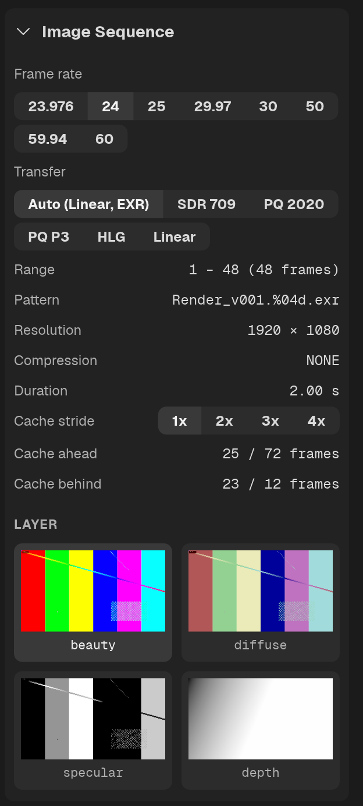

# Image Sequences

QCView plays EXR, DPX, TIFF, PNG, JPEG, TGA and BMP sequences.

## Loading a Sequence

Open or drag a single image from a sequence, and QCView automatically detects the rest of the sequence. Choose a frame rate in the Inspector panel's **Image Sequence** group; for multi-layer EXR files, the group also lists the layers as thumbnails, and clicking one loads that layer.

> Large multi-layer EXRs and high-resolution TIFF sequences (4K+) can exceed what CPU-bound decompression can deliver in real time, regardless of thread count. Use the stride option — see below.

---

## Playback Cache

Image sequences are cached to RAM as you traverse the timeline. A line along the bottom of the timeline shows how much read-behind and read-ahead is available at the current playhead position, and the Inspector's **Cache ahead** and **Cache behind** rows give the same as frame counts. The cache's size and thread count are in [Settings](/settings/#image-sequence-settings).

## Colour interpretation

The **Transfer** chips in the Image Sequence group tell QCView how to read the frames when the format rule is wrong for them. **Auto** reads EXR as scene-linear and everything else as sRGB; pick `SDR 709`, `PQ 2020`, `PQ P3`, `HLG` or `Linear` to say otherwise. Single stills are one-frame sequences and get the same chips. See [Color](/color/) for the clip's colour chain and the waveform.

## Broken and Missing Frames

QCView detects incomplete sequences and fills gaps with the last good frame so you can review in-progress renders. A red mark appears over each missing or unreadable frame in the timeline.

## Stride

Because EXRs are heavy and decompression is CPU-bound, you will eventually load something that causes playback to overrun the cache. The **Cache stride** chips in the Inspector panel help here. Picking the `2x`, `3x` or `4x` options will skip frames and allow you to play back heavy sequences for review; `1x` plays every frame.
