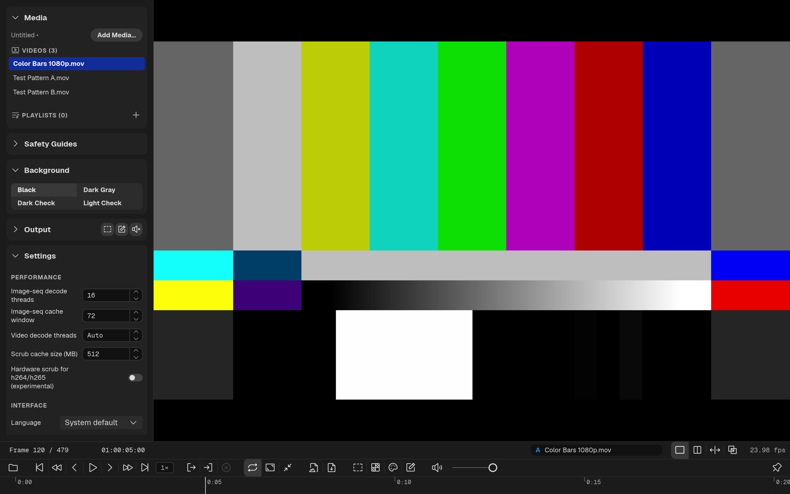

# QCView
---

**QCView** is a media player and reviewer for Windows and macOS, built for artists and post-production teams who need accurate, color-managed playback of video, EXR, and image sequences.

---

## Key Features

### Playback
- Hardware-accelerated video decoding — D3D12VA on Windows (with FFmpeg's Vulkan decoder for ProRes), VideoToolbox on macOS, with FFmpeg software fallback
- HDR on both systems with no display mode to pick: Extended Dynamic Range (EDR) on macOS, and on Windows a floating-point surface on an HDR monitor or a 10-bit surface on an SDR one, chosen by the monitor the window is on
- Frame-accurate stepping with press-and-hold fast forward / rewind, and review speeds
- Playlists with cross-clip seek, per-clip in/out trims edited directly on the timeline, and hover thumbnails
- Embedded timecode with selectable origin
- Audio playback (WASAPI / CoreAudio) with a Mix picker for 5.1 and 8-channel deliveries
- A/V sync offset trim, with separate values for dual view and live feeds

### Image Sequences
- [OpenEXR](https://openexr.com/) with multichannel and multipart support
- TIFF, PNG, JPEG, DPX, TGA and BMP sequence playback

### Color
- Two colour engines, with one colour chain per clip and per side of a dual view; clips without a chain of their own follow a project default
- **minColor**, the default engine: Input → Highlight Knee → Rendering (un-tone-mapped, OpenDRT or AgX), from the minColorAE core, with no config to set up
- Live [OCIO](https://opencolorio.org/) color management as the option, with bundled configs (ACES 2.0, ACES 1.3, Blender 5.2) or a config file of your own
- Highlight Knee for reviewing HDR masters on SDR displays
- On OCIO chains, a Scene LUT (`.cube`, `.3dl`, `.csp`) or an ASC CDL (`.cc`, `.ccc`, `.cdl`), and **Export LUT** to write a clip's chain out as a `.cube`
- **Video gamma**: shows a chain's SDR picture the way an unmanaged Rec.709 desktop does
- GPU waveform (percent on SDR, nits on HDR) with a peak readout, and a per-clip Transfer override for sources without usable tags
- Screenshots, thumbnails and notes exports go through the clip's colour chain

### Live Feeds and Output
- Live sources: After Effects and Premiere Pro through [QCBridgeAE](/qcbridge/adobe/) (full-float picture, Premiere's audio), Blender through [QCBridge](/qcbridge/blender/), and SRT streams
- Notes on a live feed: freeze the frame, draw, review it again later; notes live in the project with capture time and host timecode, and open in minNotes
- Output: the corrected viewport with mixed audio as an NDI® source ([QCBridgeN](/qcbridge/ndi/)), or out of an AJA device's SDI and HDMI as 10-bit RGB at 1080p or UHD, SDR, PQ or HLG ([QCBridgeA](/qcbridge/aja/))

### Review Tools
- Annotations + notes with freehand (smoothed), rectangle, oval, arrow and line tools, note markers on the timeline, and Markdown / HTML / PDF / DOCX export
- Dual-view comparison: side-by-side, split-wipe with mouse-drag seam, difference mode, a colour chain per side, a live feed on either side
- Title-safety guides for broadcast and social-media deliverables
- Live background switching for alpha-channel review
- **Compact Mode** (`Ctrl + Shift + C`): the window becomes the picture plus one slim strip, no title bar, no panels
- **Always on Top** (`Ctrl + Alt + T`): a pin on the transport row and the Compact strip keeps the window above every other app's, and is remembered

### Project Support
- Adobe project metadata (Premiere / After Effects timecode + project links), read from the file itself
- Custom project files (`.qcvproj`); projects saved by QCView 2.x open as they are
- `qcview://` URI scheme for sharing file paths
- An interface in English and eleven other languages

---

## Documentation

Use the sidebar to browse the full manual, including [installation](installation), [playback basics](app-basics), [color management](color), [annotations](annotations), and more.

---

## Links

- [Source Code — QCView 3 (minplatform)](https://github.com/cbkow/minplatform)
- [Source Code — QCView 2 (the `2.x` branch of QCView-Player)](https://github.com/cbkow/QCView-Player/tree/2.x)
- [This site (QCView-Player)](https://github.com/cbkow/QCView-Player)
- [Releases](https://github.com/cbkow/QCView-Player/releases)
- [Privacy Policy](privacy)

The third-party notices ship with the app: **About → Licenses…** opens them.

QCView is free software released under the GNU General Public License version 3.
