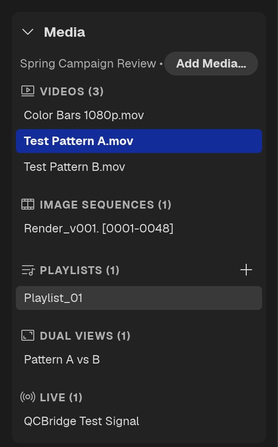
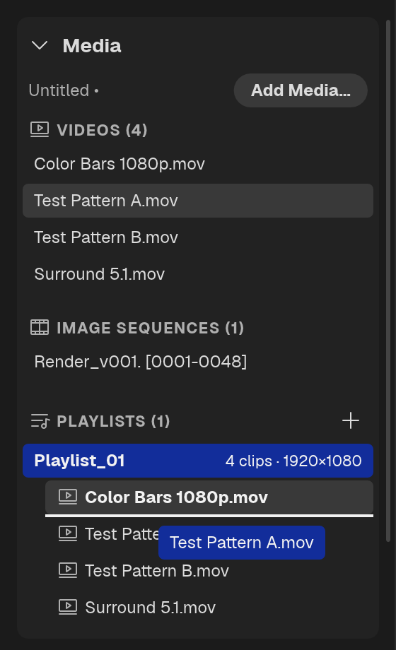

# Project Panel

The project's media lives in the **Media** section at the top of the Left Rail (`Ctrl + 1`). The section's title carries the project's name: **Untitled** until you save, then the project file's name, with a **•** after it while there are unsaved changes. The window title shows the same.

## Bins

The list is grouped by type, each group with a count:

- **Videos**, **Audio**, **Images** and **Image Sequences** — the files you have added
- **Playlists** — saved playlist timelines
- **Dual Views** — saved A/B dual-view setups
- **Live** — streams and QCBridge sources

Click **Add Media…** to open the file dialog, or drop files on the rail. An empty project reads "Drop media here to add to the project".

| Action | Result |
|---|---|
| Click an item | Select it. `Ctrl` / `⌘` + click adds or removes one; `Shift` + click selects a range |
| Double-click a media item | Load it into the viewport and timeline |
| Double-click a playlist or dual view | Load that timeline / dual setup |
| Drag a media item | Drop onto the viewport, into a playlist's timeline or its list of clips, or onto a dual-view chip or side of the picture |
| `F2` | Rename the selected item |
| `Delete` / `Backspace` | Remove the selected items from the project. The message that follows has an **Undo** button |
| `Ctrl + A` / `⌘ + A` | Select all media |
| Right-click | **Create Playlist from Selection**, **Delete** |

The item on screen is highlighted with its name in bold. A file QCView cannot play (an unsupported format, or un-debayered camera raw) carries a warning mark on its row.

### A loaded playlist's clips

When a playlist is loaded, its row opens into a list of its clips, with the clip count and frame size beside the playlist's name. Click a clip to jump to it; the clip that is playing is marked. Drag a clip up or down to reorder the playlist, and drag media items from the groups above into the list to add them: onto the line between two clips to insert there, or onto the playlist's own row to add at the end. See [Playlists](/playlists/).

---

## Save / Load Projects

Save your current session — all media, playlists, dual views, and per-item properties — to a `.qcvproj` file. Reopen it to pick up where you left off. Projects saved by QCView 2 open in 3.0.

---

## Project Links

QCView registers a `qcview://` URI scheme for sharing direct links into saved projects. Load the item you want to point at and choose **File → Copy Project Link**; the link names the project and that item. Paste it into Slack, Teams, or email; clicking it opens the project and loads the item.

A link finds its project in the recipient's **Open Recent Project** list, so they need access to the same file system and need to have opened the project once before. Otherwise QCView says the project isn't in their recent projects.

<!-- SHOT qcv3_024: The File menu with Copy Project Link highlighted, and the "Project link copied" message -->
