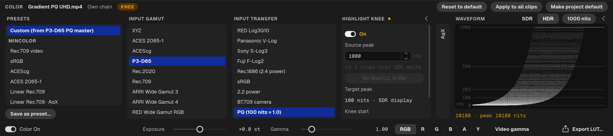
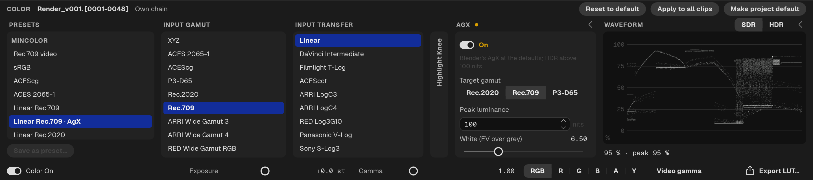

# minColor

**minColor** is QCView's default color engine: the core of the [minColorAE](https://github.com/cbkow/minColorAE) plug-in built into QCView. It is a fixed chain with no config file. It reads the source in a named gamut and transfer, and optionally shapes it with the Highlight Knee and AgX.

Every built-in preset is a minColor preset, and a project that has not set its own default uses the minColor **Rec.709 video** chain. This page covers minColor's own columns; the drawer as a whole (the On / Off switch, one chain per clip, presets, the waveform, Export LUT) is on the [Color](/color/) page.

---

## The chain

On a minColor chain the drawer reads left to right: Presets, **Input gamut**, **Input transfer**, **Highlight Knee**, **AgX**, then the waveform. All of it belongs to the clip you are editing, like any chain (see [One chain per clip](/color/#one-chain-per-clip)).

Scene values travel in linear Rec.2020 between the steps. A change is a parameter update, not a rebuild, so sliders respond straight away.

### Input

- **Input gamut** — the source primaries: XYZ, ACES 2065-1, ACEScg, P3-D65, Rec.2020, Rec.709, and the camera gamuts (ARRI Wide Gamut 3 / 4, RED Wide Gamut RGB, Sony S-Gamut3 / S-Gamut3.Cine, Panasonic V-Gamut, Apple Wide Gamut, Canon Cinema Gamut, Blackmagic Wide Gamut Gen 5, DJI D-Gamut, Filmlight E-Gamut / E-Gamut2, DWG).
- **Input transfer** — how the file's code values decode: Linear, the camera logs (DWG Intermediate, Filmlight T-Log, ACEScct, ARRI LogC3 / LogC4, RED Log3G10, Panasonic V-Log, Sony S-Log3, Fuji F-Log2, Apple Log, Canon Log 2 / Log 3, Blackmagic Film Gen 5, DJI D-Log), the display decodes (Rec.1886, sRGB, 2.2 power, BT.709 camera), and the HDR ones (PQ with 100 nits at 1.0, HLG at 1000 nits).

### Highlight Knee

The same knee as on an OCIO chain: it compresses highlights above the source peak into the display's range. See [Highlight Knee](/color/#highlight-knee) for the controls. It is off in every built-in preset, and the card stays collapsed to a strip until you open it.

### AgX

An optional picture formation: a parametric, HDR-capable AgX that matches Blender's at its defaults. Click the **AgX** strip to open the card, then switch it on.

| Control | What it does |
|---|---|
| **Target gamut** | The gamut the picture is kept inside: Rec.2020, Rec.709 or P3-D65 |
| **Peak luminance** | 100 nits is SDR; above it the curve opens up for an HDR display |
| **White / Black (EV)** | Stops over and under grey that reach the top and the floor (6.5 / −10) |
| **Contrast, Toe power, Shoulder power** | The sigmoid's slope at the pivot and the shape of its ends |
| **Hue restore** | How much of the pre-curve hue is kept (0.6, as Blender) |
| **HDR purity** | Hue and saturation restored around the grey darkening on HDR peaks |

Double-click a slider to put it back to its default.

With AgX off the chain is **un-tone-mapped**: the scene values go to the screen as the Input describes them. That is what minColor is mostly for, describing media and converting between encodings rather than interpreting it.

---

## Presets

The built-in presets are one per input. There are no per-display variants, because there is no display to choose (see [HDR](/hdr/)):

| Preset | Input gamut | Input transfer | AgX |
|---|---|---|---|
| **Rec.709 video** | Rec.709 | Rec.1886 | off |
| **sRGB** | Rec.709 | sRGB | off |
| **ACEScg** | ACEScg | Linear | off |
| **ACES 2065-1** | ACES 2065-1 | Linear | off |
| **Linear Rec.709** | Rec.709 | Linear | off |
| **Linear Rec.709 · AgX** | Rec.709 | Linear | on |
| **Linear Rec.2020** | Rec.2020 | Linear | off |
| **Linear Rec.2020 · AgX** | Rec.2020 | Linear | on |
| **P3-D65 PQ master** | P3-D65 | PQ | off |
| **Apple Log** | Rec.2020 | Apple Log | off |
| **Apple Log 2** | Apple Wide Gamut | Apple Log | off |
| **Canon Log 2** | Canon Cinema Gamut | Canon Log 2 | off |
| **Canon Log 3** | Canon Cinema Gamut | Canon Log 3 | off |
| **Blackmagic Film Gen 5** | Blackmagic Wide Gamut Gen 5 | Blackmagic Film Gen 5 | off |
| **DJI D-Log** | DJI D-Gamut | DJI D-Log | off |

**P3-D65 PQ master** reads a PQ master graded in P3-D65. On an HDR display it shows as HDR. On an SDR display its highlights clip until you turn on the Highlight Knee (1000 → 100 nits is the starting setting) to bring them into range.

The six camera presets (new in 3.0.4) read a camera original. A log file holds the scene's light: un-tone-mapped, as these presets are, everything above diffuse white clips on an SDR display. Turn AgX on in its card for a finished-looking picture. QCView does not detect these encodings from the file: pick the preset for the clip, or make it the project's default. Apple Log 2 is Apple Log's curve on a wider gamut. Blackmagic Film Gen 5 is for footage already in that encoding, such as ProRes from the camera; QCView does not open `.braw` files. DJI's D-Log M is a different encoding and has no preset.

Saving your own presets works the same for both engines: change a column, then **Save as preset…** on the **Custom** row. See [Presets](/color/#presets).

---

## Everything else works the same

Screenshots are taken through the SDR equivalent of the chain (AgX at a 100-nit peak), so a chain set up for an HDR display still saves a correct SDR file. **Export LUT…** bakes the minColor chain to a `.cube` the same way. The [waveform](/color/#waveform) reads the source through the clip's Input gamut and transfer, before the Knee and AgX. The viewer aids (Exposure, Gamma, channel view) and Video gamma apply as they do on an OCIO chain.

A clip is on one engine at a time. Picking an OCIO preset or **New OCIO chain…** replaces the clip's minColor chain; picking a minColor preset puts it back on minColor.

---

## Credits

minColor is GPL-3.0, like QCView. Its rendering is derived from [OpenDRT](https://github.com/jedypod/open-display-transform) v1.1.0 by Jed Smith, modified; minColor AgX ports parts of [darktable](https://github.com/darktable-org/darktable)'s AgX module by István Kovács and the darktable developers, and follows the primaries and HDR method of Blender's AgX by Zijun Eary Zhou (Eary Chow), Mark Faderbauer and Sakari Kapanen; AgX is by Troy Sobotka. QCView is not affiliated with or endorsed by any of them. The full notices open from **About > Licenses…**.
