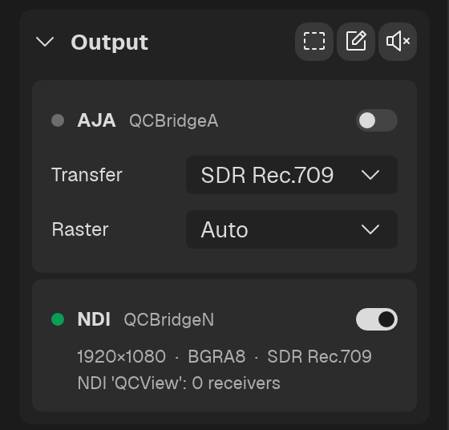
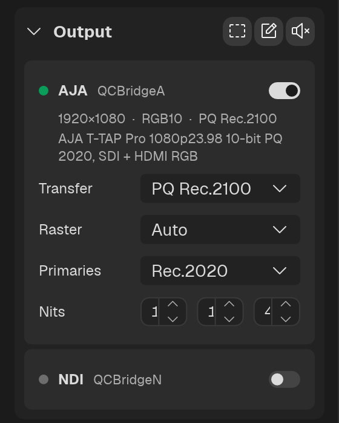

# Output

The **Output** section in the Left Rail sends what the viewport shows, with the mixed audio: as an NDI® source, or out of an AJA device's SDI and HDMI. Each needs its QCBridge add-on installed; with none installed the section reads "No outputs found".

Each output is a card: a status dot, its name, and an on / off switch, then two quiet lines — what is being sent (raster, format and transfer) and the sink's own report — and the settings that output lets QCView choose. The dot is green while the output is live; hover it for the reason when it is waiting for the sink, refused, or not installed. Nothing is sent until the switch is on. Switching an output on does not change playback.

## What goes out

- **The picture** is the viewport's composite at the output's raster, letterboxed when the aspect differs. OCIO or minColor transforms, dual-view layouts and the difference view are applied as on screen.
- **Mute feed** (the speaker in the section's header) silences the audio on every output without touching your own monitoring. **The feed starts muted**, so switch it on to send sound. The master mute (`M`) silences both your monitoring and the outputs.
- **Guides** and **Notes** (the other two toggles in the header) add the safety guides and the note strokes as layers. Note strokes go out only while the viewport draws them: with the Notes panel open, in single view. A frozen frame in Review is sent as the viewport shows it.
- **Live feeds** go out at the feed's own rate (a 23.976 Premiere sequence stays 23.976).
- **Dual view** goes out as the layout on screen. The audio is the first side that is heard: A when both are unmuted.
- **Raster** (per output, for sinks that leave it to QCView such as the AJA sink): **Auto** sends UHD (3840×2160) for anything above 1080p and 1080p otherwise, switching when the source changes; **1080p** and **UHD** fix it. The picture is letterboxed into the raster either way.
- **Transfer** (per output, for sinks that carry it such as SDI or HDMI): SDR Rec.709, PQ Rec.2100 or HLG Rec.2100. QCView encodes the picture for the transfer you choose, and the wire signals the same. PQ adds the mastering metadata the monitor reads: primaries (Rec.2020 or P3-D65), peak, MaxCLL and MaxFALL in nits.

## NDI (QCBridgeN)

Install [QCBridgeN](https://github.com/cbkow/QCBridgeN/releases) (its own page: [NDI](/qcbridge/ndi/)) and switch it on in the Output section. QCView starts the sink as a separate application, publishes the viewport to it while it is attached, and the sink offers an NDI source named **QCView** on the local network. The card's second line is the sink's report, including how many receivers are connected. An NDI source is SDR Rec.709, so its card has no Transfer setting. The sink quits with QCView or when the output is switched off.

## AJA SDI / HDMI (QCBridgeA)

Install [QCBridgeA](https://github.com/cbkow/QCBridgeA/releases) 0.0.2 or later with AJA's own driver and software for the device (its own page: [AJA](/qcbridge/aja/)), and switch it on in the Output section. QCView starts the sink, which takes the device exclusively (the way AJA's applications do; it reports who holds it otherwise), asks QCView for the raster the card's Raster setting names, and sends the viewport and the mixed audio over SDI and HDMI as 10-bit RGB at the source's frame rate. The card shows the device, the format and the connectors, for example "T-TAP Pro UHDp25 10-bit PQ 2020, SDI + HDMI RGB". The transfer and the raster can be changed while it runs; the card reconfigures in place. UHD goes out as one 12G stream and needs a device with 12G routing; above 30p the HDMI side carries YCbCr, as 10-bit RGB 4:4:4 does not fit HDMI 2.0 there. The sink quits with QCView or when the output is switched off.
