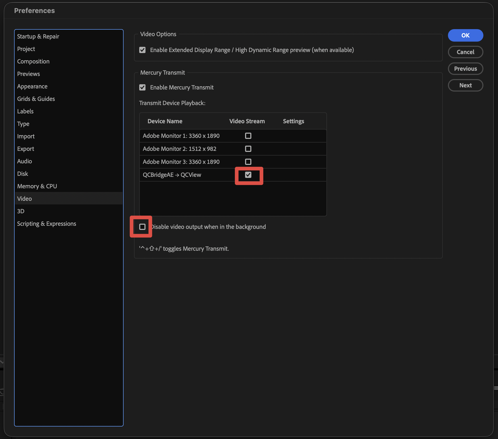
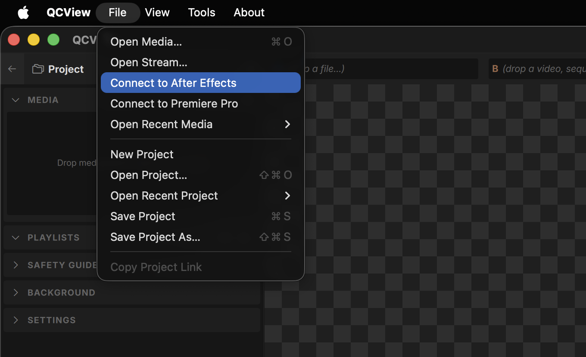
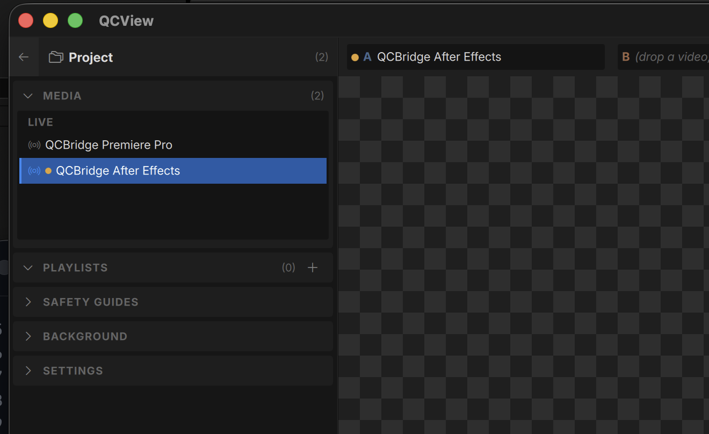

# QCBridgeAE for After Effects and Premiere Pro

[QCBridgeAE](https://github.com/cbkow/QCBridgeAE) is a **Mercury Transmit** plugin that streams live viewport output from the the AE or Premiere to QCView. The output is unaltered and full float, converted to 1/2 float in QCView so the image quality is preserved under all circumstances, including HDR scenarios.

---

## Requirements

- **QCView 2.4.0 or newer** on the same machine. Audio from Premiere Pro needs QCView 2.5.4 and QCBridgeAE 0.3.1; notes on the feed and the stream output need QCView 2.5.6.
- After Effects or Premiere Pro with Mercury Transmit (any current release).
- macOS on Apple Silicon, or Windows x64.

---

## Installation

Quit After Effects and Premiere Pro first. Download the installer from the [QCBridgeAE releases](https://github.com/cbkow/QCBridgeAE/releases):

- macOS: `QCBridgeAE-<version>-arm64.pkg` 
- Windows: `QCBridgeAE-<version>-Setup-x64.exe` 

Updating is the same step with a newer installer.

---

## Setup

**In After Effects:** *Settings → Video Preview*

1. Tick **Enable Mercury Transmit**, then tick **QCBridgeAE → QCView**.
2. **Untick "Disable video output when in the background"**. With it ticked (the default), After Effects stops sending the moment you click into QCView — QCView shows *PAUSED* and names this setting.

**In Premiere Pro:** *Settings → Playback* — the same two ticks, and the same background setting to untick.

**In QCView:** *File → Connect to After Effects* (or *Connect to Premiere Pro*). The source appears in the **Live** bin as **QCBridge After Effects** / **QCBridge Premiere Pro** and waits until the host is sending.

**Set QCView's OCIO input to your project's working space.** The pixels arrive in the host's working colour space, untransformed. With Adobe colour management that is the project's working space; with OCIO colour management, the OCIO working space (for example ACEScg).

The feed carries no colour tag, so with OCIO off the scopes read it as SDR. The **Transfer** chip on the live strip tells them what it is: `Linear` for a linearised working space, `SDR 709` for a display-referred one, `PQ 2020` for an HDR project. See [HDR sources without tags](/hdr/#hdr-sources-without-tags).

---

## What to expect

- Frames are RGBA16F. The host sends 32-bit float; values above 1.0 and negatives are kept, and nothing is clamped. 
- After Effects flattens transparency over the **comp background colour**, so its frames are opaque. Premiere Pro carries **straight alpha**.
- Mercury Transmit is always a few frames behind AE (Just how it works and shares the same issue with Blackmagic, Aja, or other plugins), but Premiere is fairly tightly synced — depending on system resources and timeline resolution.
- You can stream from AE and Premiere at the same time and between them, or use them in QCView Dual View review modes.

---

## Audio from Premiere Pro

Premiere Pro can push the sequence's audio alongside the picture. In *Settings → Playback*, tick **Audio Stream** for the QCBridgeAE device. The Inspector's **Audio** card then shows the stream's state, rate and channels with per-channel meters.

- **Listen in QCView** plays the feed's audio through QCView. It is off by default — Premiere is already playing it — and useful when QCView is on another output or when the feed is sent on through the Output section, which carries the audio whether you listen or not.
- 5.1 and 7.1 sequences fold to stereo by the same routing rules as files; **Mute scrub audio** applies to the feed too.
- **A/V sync (Live)** in Settings delays the audio or holds the picture, per host application, to line the two up on your system.
- Live audio keeps a small jitter buffer that fills before it plays and refills after an underrun, so a busy Premiere does not chop the sound.

After Effects sends picture only.

## Working with the feed in QCView

- **The transport keys leave the feed alone.** Play/pause, frame step, shuttle and seek have no meaning for a feed, so they are ignored; `M` mutes it. On a live item, `Space` freezes the feed for a note and brings it back — see [Notes on live feeds](/annotations/#notes-on-live-feeds).
- **Notes** on a feed capture the frame you are looking at and live in the QCView project. For Premiere Pro each note records the sequence timecode it came from.
- **Dual view** takes a feed on either side. It keeps playing, with its audio in the mix, while the file side is paused, stepped or shuttled. See [Dual View](/dual-view/#live-sides).
- **Sending it on.** The [Output](/output/) section publishes the viewport — the feed with QCView's colour transform, guides and notes — as an NDI® source or as an H.264 stream to a review service.
