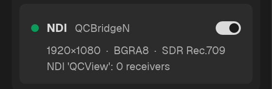

# QCBridgeN for NDI®

[QCBridgeN](https://github.com/cbkow/QCBridgeN) goes the other way from the Adobe and Blender add-ons: it takes what QCView shows and plays — the viewport with its colour transform, dual-view layouts, guides and notes, plus the mixed audio — and offers it on the local network as an **NDI source named QCView**. Any NDI receiver can pick it up: NDI Video Monitor, a switcher, OBS, another QCView on the network.

It runs as its own small application beside QCView. QCView starts it when the output is switched on and stops it when the output is switched off or QCView quits.

---

## Requirements

- **QCView 3.0** on the same machine.
- macOS 13 or later on Apple Silicon, or Windows 10 1809 or later, x64.
- A network the receivers share. The NDI runtime is inside the application; an installed NDI runtime is used instead when there is one.

---

## Installation

Download the installer from the [QCBridgeN releases](https://github.com/cbkow/QCBridgeN/releases):

- macOS: `QCBridgeN-<version>-arm64.pkg`
- Windows: `QCBridgeN-<version>-Setup-x64.exe`

Each installs the application and registers it with QCView, which lists it in the Output section from the next launch. Updating is the same step with a newer installer. The Windows installer is not code-signed yet, so SmartScreen asks once.

---

## Setup

1. In QCView, open the **Output** section in the left rail and switch the **NDI** card on. QCView starts QCBridgeN; the card's dot turns green once the output is live, and its second line is the sink's report, including how many receivers are connected.
2. On the receiver, pick the source **QCView** under this machine's name.

QCBridgeN also sits in the menu bar (macOS) or the tray (Windows), lit while frames flow. Its **Settings…** has the source name, the raster (1080p by default, up to 3840×2160), the picture — the whole viewport, or side A or side B of a dual view — and which layers it asks for. The feed mute and the layers QCView allows are the three toggles in the header of QCView's Output section. **The feed starts muted**, so a first NDI session is silent until you switch the speaker on.

---

## What to expect

- The source carries the picture as QCView shows it, so the clip's OCIO or minColor chain, splits, wipes and the difference view go out as on screen. It is a Rec.709 SDR source.
- The frame rate follows the source: a file plays at its rate, a Premiere or After Effects feed at the feed's, a paused picture repeats its last frame.
- The audio is the mixed audio QCView plays, taken before your own monitoring volume. **Mute feed** silences it on every output and leaves your monitoring alone; the master mute (`M`) silences both. In dual view the output carries the first side that is heard.
- Guides and note strokes go out when their toggles are on; note strokes only while the Notes panel is open in single view. A frozen frame in Review goes out as the viewport shows it, so a receiver sees what the reviewer sees.
- Switching the output off, or quitting QCView, ends the source; the receiver reports it gone.

---

## Why a separate application

QCView is GPL and the NDI SDK's licence does not allow linking the two into one program, so the sink is its own process and QCView hands it frames through shared memory. The details are in the project's `PLAN.md`.

NDI® is a registered trademark of Vizrt NDI AB. QCBridgeN is compatible with NDI products; it is not an NDI product.
