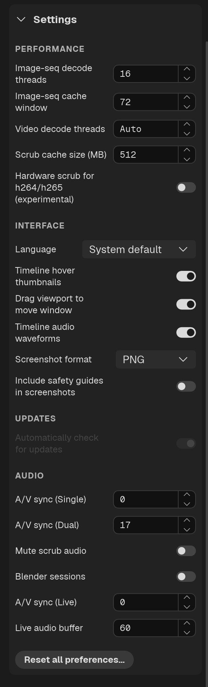

# Settings

Open Settings with `Ctrl + ,` (or **Tools → Settings…**). The panel reveals in the Left Rail under the **Settings** section, in groups: **Performance**, **Interface**, **Updates** (macOS) and **Audio**. Hover a setting's name for a line about what it does.

QCView 3.0 starts from its own defaults: settings from QCView 2 are not imported. Projects saved by QCView 2 still open.

## Performance

**Video decode threads** sets how many threads decode a video file; `0`, shown as **Auto**, lets QCView choose. On Windows, **Enable hardware decoding** uses the GPU to decode when the format allows; it is on by default. **Scrub cache size (MB)** is how much memory holds decoded frames near the playhead while you scrub, and **Hardware scrub for h264/h265 (experimental)** decodes those formats on the GPU while scrubbing. All four apply the next time you open a file.

## Image Sequence Settings

**Image-seq decode threads** and **Image-seq cache window** (the frames cached ahead of the playhead) are in the Performance group. They are already set fairly aggressively by default. Consider making them smaller on a computer with fewer threads or less RAM; increasing these is unlikely to be beneficial. The thread count applies on the next sequence load.

## A/V Sync Offset

A default A/V sync offset trim is applied at session start. **A/V sync (Single)** and **A/V sync (Dual)**, in the Audio group, let you customize them to your system; positive values delay the audio. The single-source flow and dual-view flow store separate offsets — your sync trim for compositing two sources doesn't get applied to single-source playback and vice versa. A change applies on the next seek or play.

**Mute scrub audio**, in the same group, silences the audio you hear while scrubbing and shuttling.

## Drag Viewport to Move Window

On by default. Click and drag anywhere on the viewport to move the whole window, the way media players do; this works in Compact Mode too. A plain click still does nothing, and the drag does not move the window while a drawing tool is selected, while you are dragging the Split-Wipe seam, or in fullscreen. Turn it off here if you use a tablet and would rather a press with no tool never moves anything.

## Hover Thumbnails

**Timeline hover thumbnails** toggles the timeline hover thumbnail preview on or off (low-RAM systems or focus-mode users may prefer it off). See [Thumbnails](/thumbnails/).

## Timeline Audio Waveforms

On by default. Draws the clip's audio waveform as a faded fill in the timeline. The waveform is read in the background after the clip opens.

## Screenshots

**Screenshot format** picks the file a Desktop screenshot (`T`) writes: **PNG** (the default), **PNG 16-bit**, **JPEG** or **TIFF 16-bit**. JPEG is smaller; PNG and TIFF are lossless.

**Include safety guides in screenshots** draws the active safety guide into Desktop and clipboard screenshots. It is off by default.

See [Screenshots](/timeline/#screenshots).

## Language

Settings ▸ Interface ▸ Language picks the interface language. **System default** follows the operating system; the list shows the languages QCView ships. The change applies at once. Corrections to a translation are welcome: the catalogs are the `.po` files in the [i18n folder](https://github.com/cbkow/minplatform/tree/main/apps/qcv/i18n) of the source repository.

## Updates

macOS only. **Automatically check for updates** checks once a day; you can also check at any time with **About → Check for Updates…**. On Windows, QCView updates through the Microsoft Store.

## Blender sessions

Off at every launch, and the same switch as **File ▸ Connect to Blender**. QCView does nothing for Blender until you turn it on; then it watches for the card the QCBridge for Blender host add-on writes on this machine when a session starts, listens on the card's port and shows the replica's stream as a live clip, now or when the session starts. The stream is shown on QCView's own terms: the host's colour setup does not change the clip's colour in QCView. The line under the switch says what is happening — no session yet, listening for the host on a port, live, or ended — and any problems the host reports appear under it in red. Turning it off stops listening and removes the Blender clip; deleting the clip from the bin does the same. New Project or Open Project while connected keeps the connection: the clip joins the new project. See [QCBridge for Blender](/qcbridge/blender/).

## Live audio

Two settings apply to the audio a QCBridge feed carries: **A/V sync (Live)**, an offset per host application that delays the audio (or, when negative, holds the picture) so the two meet on your system, and the **Live audio buffer**, how much of the feed's audio is queued before it plays, in milliseconds.

## Output

Outputs — the NDI® sink and the AJA SDI / HDMI sink — are not in Settings: they have their own **Output** section in the Left Rail. See [Output](/output/).

## Reset all preferences

**Reset all preferences…**, at the bottom of the section, puts every setting back to its default after a confirmation, including the window's size and position and the rails' layout. Open media stays open.
