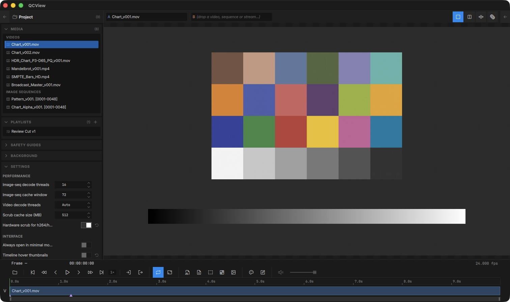

# Settings

Open Settings with `Ctrl + ,` (or **Tools → Settings…**). The panel reveals in the Left Rail under the **Settings** section.

## Image Sequence Settings

Image sequence threading and cache window sizes are already set fairly aggressively by default. Consider making them smaller on a computer with fewer threads or less RAM; increasing these is unlikely to be beneficial.

## A/V Sync Offset

A default A/V sync offset trim is applied at session start. Here you can customize them to your system. The single-source flow and dual-view flow store separate offsets — your sync trim for compositing two sources doesn't get applied to single-source playback and vice versa.

## Drag Viewport to Move Window

On by default. Click and drag anywhere on the viewport to move the whole window, the way media players do. A plain click still does nothing, and the drag does not move the window while a drawing tool is selected, while you are dragging the Split-Wipe seam, or in fullscreen. Turn it off here if you use a tablet and would rather a press with no tool never moves anything.

## Hover Thumbnails

Toggle the timeline hover thumbnail preview on or off (low-RAM systems or focus-mode users may prefer it off).

## Language

Settings ▸ Interface ▸ Language picks the interface language. **System default** follows the operating system; the list shows the languages QCView ships. The change applies on the next launch. Languages marked *machine translation* were produced by a machine pass and not yet read through by a person, so expect the odd awkward term; corrections are welcome, and the [translations folder](https://github.com/cbkow/QCView-Player/tree/main/translations) explains how to send them.

## Live audio

Two settings apply to the audio a QCBridge feed carries: **A/V sync (Live)**, an offset per host application that delays the audio (or, when negative, holds the picture) so the two meet on your system, and the **live audio buffer**, the depth the feed's jitter buffer fills to before it plays. Raise the buffer if a busy host chops the sound; lower it for a tighter feel.

## Output

Outputs — the NDI® sink, the AJA SDI / HDMI sink and the stream to a review service — have moved out of Settings into their own **Output** section in the Left Rail. See [Output](/output/).
