# Timeline and Transport Controls

Three bands sit under the viewport: the status strip with the frame and timecode readouts, the transport row with the playback controls, and the timeline. Click on the timeline to seek to a location, or drag to scrub. A playlist adds a clip bar under the timeline, and dual view adds two lanes, A over B.

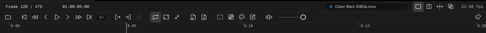

## Transport

| Button | Action | macOS | Windows |
|---|---|---|---|
| Beginning | Jump to start of media | `Home` (or `Fn + ←`) | `Home` |
| Rewind | Press and hold — accelerates over time | `A` / `J` (hold) | `A` / `J` (hold) |
| Back one frame | Step back one frame (hold to keep stepping) | `Q` / `←` | `Q` / `←` |
| Play / Pause | Toggle playback | `Space` / `K` / `W` / `S` | `Space` / `K` / `W` / `S` |
| Forward one frame | Step forward one frame (hold to keep stepping) | `E` / `→` | `E` / `→` |
| Fast-forward | Press and hold — accelerates over time | `D` / `L` (hold) | `D` / `L` (hold) |
| End | Jump to end of media | `End` (or `Fn + →`) | `End` |

Left to right, the row holds: **Open media…**, the transport buttons above with the review-speed chip beside them, In / Out / Clear, loop, fullscreen and Compact Mode, the two screenshot buttons, Safety guides, Background, the Color and Notes panel toggles, and mute with the volume slider. Flush right, apart from the rest, sits the pin (Always on Top, `Ctrl + Alt + T`), which keeps the window above other apps and is remembered — see [Layout Presets](/app-basics/#layout-presets).

On a live feed the transport keys are ignored and `M` mutes it; `Space` freezes the feed for a note and brings it back (see [Notes on live feeds](/annotations/#notes-on-live-feeds)).

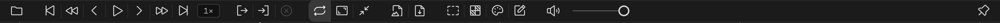

### Review speed

The chip beside the transport buttons shows the playback speed, `1×` at rest. Click it, or press `R`, to step through 0.5×, 0.75×, 1×, 1.25×, 1.5× and 2×. `Shift`-click it, or press `Shift + R`, to go straight back to 1×.

| Control | Action | macOS | Windows |
|---|---|---|---|
| Speed chip | Next review speed | `R` | `R` |
| Speed chip (`Shift`-click) | Back to 1× | `⇧ + R` | `Shift + R` |

---

## Screenshots

Two screenshot buttons capture the picture:

| Button | Action | macOS | Windows |
|---|---|---|---|
| Clipboard | Copies the screenshot to the system clipboard | `⌘ + T` | `Ctrl + T` |
| Desktop | Saves a screenshot file to your Desktop | `T` | `T` |

The Desktop file is named after the media, with the date and time added. Its format is the **Screenshot format** in [Settings](/settings/): PNG (the default), PNG 16-bit, JPEG or TIFF 16-bit. The clipboard copy is 8-bit.

A screenshot is the picture you are reviewing, written as a standard SDR image:

- The clip's colour chain is applied. When the picture on screen is HDR, the screenshot uses the SDR version of the same chain. With Color off, an SDR source is written as stored and an HDR (PQ / HLG) source is tone-mapped to SDR.
- **Video gamma** is included when it is lit (see [Color](/color/)).
- The clip's pixel aspect and rotation are applied.
- When the media has transparency, PNG and TIFF screenshots keep the alpha channel. JPEG is always opaque.
- Annotations are included while the Notes panel is open and showing them. Safety guides are included only with **Include safety guides in screenshots** turned on in Settings.

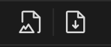

---

## Timecode and Frames

The left end of the status strip shows the current frame (`Frame 120 / 479`) and the timecode; the frame rate is at the right end.

Click the frame readout to go to a frame, or the timecode readout to go to a timecode. Type the number and press `Enter`; `Esc` closes the box without moving. A timecode can be typed as digits only and is padded from the right, so `1000` means `00:00:10:00`.

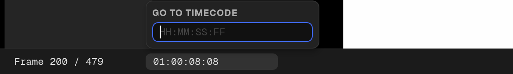

For video files with embedded timecode, that timecode will be used. The Inspector's **Origin** chips (in its Timecode group) let you pick which timecode to follow per source. See the [Inspector](/inspector/) page for more info.

---

## The Timeline

The timeline is one band that is also the ruler. It shows:

- time ticks and labels along the top, and frame ticks once you zoom in far enough;
- the playhead, and the in / out zone when one is set;
- the clip's audio waveform as a faded fill (turn it off with **Timeline audio waveforms** in [Settings](/settings/));
- for image sequences, a line along the bottom for the frames cached behind and ahead of the playhead, and a red mark for every frame that is missing or could not be read;
- a pennant for every note on the clip.

### Note pennants

Each note on the loaded clip has a violet pennant on the bottom edge of the timeline: filled for an open note, hollow for one marked addressed. Hover a pennant to read the note's timecode and text; click it to jump to the note. Pennants show in single view for a file. A live feed, a playlist, dual view and the Compact Mode strip have none. See [Annotations](/annotations/).

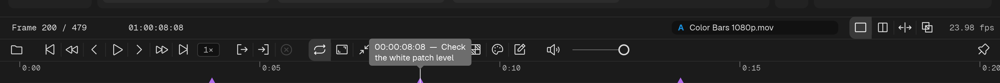

## Dropping media on the timeline

With a playlist loaded, the timeline and the clip bar under it are drop targets: drop a file, or an item from the Media section, to insert it into the playlist (see [Playlists](/playlists/)).

In single and dual view the timeline does not take drops. Drop on the picture to load a file, and in dual view on the **A** or **B** chip, or on that side of the picture (see [Dual Video Review](/dual-view/)).

## Zoom and Pan

| Action | macOS | Windows |
|---|---|---|
| Zoom in / out on the timeline, around the pointer | `Wheel` | `Wheel` |
| Zoom in / out, around the playhead | `⌘ + =` / `⌘ + -` | `Ctrl + =` / `Ctrl + -` |
| Pan the timeline | `⌥ + Wheel`, or drag with the middle button | `Alt + Wheel`, or drag with the middle button |
| Fit the whole timeline | Double-click the timeline | Double-click the timeline |

When you are zoomed in, a thin marker along the bottom of the timeline shows which part of the whole you are looking at, and during playback the view turns the page as the playhead reaches the edge. Long-form content (feature films) can be zoomed all the way out to show the entire timeline or zoomed into a tighter view.

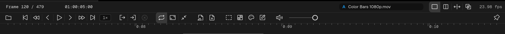

---

## Volume

Adjust the volume slider or click the speaker icon to toggle mute. Both are remembered across launches.

| Control | Action | macOS | Windows |
|---|---|---|---|
| Slider | Adjust playback volume | `↑` / `↓` | `↑` / `↓` |
| Speaker | Toggle mute | `M` | `M` |

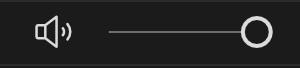

---

## Looping

Loop mode is on by default — media restarts after reaching the end. Disable it to stop at the last frame. The choice is remembered.

| Button | Action | macOS | Windows |
|---|---|---|---|
| Loop | Toggle loop mode | `V` / `⌘ + L` | `V` / `Ctrl + L` |

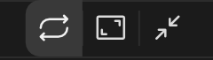

### In/Out Range

Set a loop range with the **In** and **Out** buttons. A highlighted loop zone appears on the timeline. Press **Clear** to remove the range and play the full clip.

| Button | Action | macOS | Windows |
|---|---|---|---|
| In | Set loop in point at the current frame | `I` | `I` |
| Out | Set loop out point at the current frame | `O` | `O` |
| Clear | Remove the in/out range | `⇧ + I` | `Shift + I` |

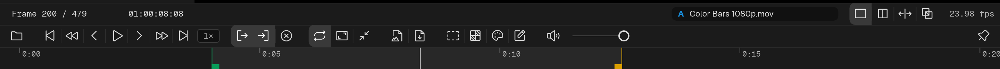

---

## Editing

There is no edit mode in QCView 3.0. Playlists and dual view put their clips on bars under the timeline, and you edit them directly: what a drag does depends on where you start it.

**Playlists** have one clip bar:

| Gesture | Result |
|---|---|
| Click a clip | Seek there and select the clip |
| Drag either end of a clip | Trim its head or tail |
| Drag the body of a clip | Move it to a new place in the order |
| `Ctrl` / `⌘` + drag a clip | Slip the source under the clip |
| Double-click a clip | Open a box with **Source in**, **Source out** and **Duration** to type exact values |

| Action | macOS | Windows |
|---|---|---|
| Split the clip at the playhead | `⌘ + K` | `Ctrl + K` |
| Delete the selected clip | `Delete` / `Backspace` | `Delete` / `Backspace` |
| Undo / redo an edit | `⌘ + Z` / `⇧ + ⌘ + Z` | `Ctrl + Z` / `Ctrl + Shift + Z` |

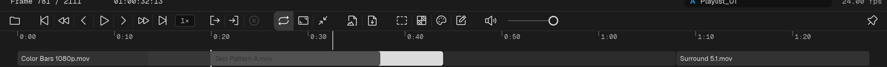

**Dual view** has two lanes, A over B. The gestures are the same, except that dragging the body of a clip slides it in time rather than reordering it. Clicking a clip, or its side's chip, makes that side the target for the keys below.

| Action | macOS | Windows |
|---|---|---|
| Trim the clip's head to the playhead | `[` | `[` |
| Trim the clip's tail to the playhead | `]` | `]` |
| Cut the target side at the playhead | `⌘ + K` | `Ctrl + K` |
| Slide the clip one frame | `⌥ + ←` / `⌥ + →` | `Alt + ←` / `Alt + →` |
| Slide the clip ten frames | `⌥ + ⇧ + ←` / `⌥ + ⇧ + →` | `Shift + Alt + ←` / `Shift + Alt + →` |
| Delete the clip and leave a gap | `Delete` | `Delete` |
| Delete the clip and close the gap | `⇧ + Delete` | `Shift + Delete` |
| Undo / redo an edit | `⌘ + Z` / `⇧ + ⌘ + Z` | `Ctrl + Z` / `Ctrl + Shift + Z` |

See [Playlists](/playlists/) and [Dual Video Review](/dual-view/) for the details.

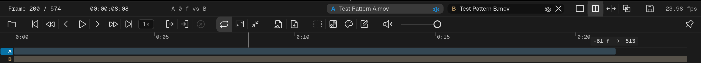
